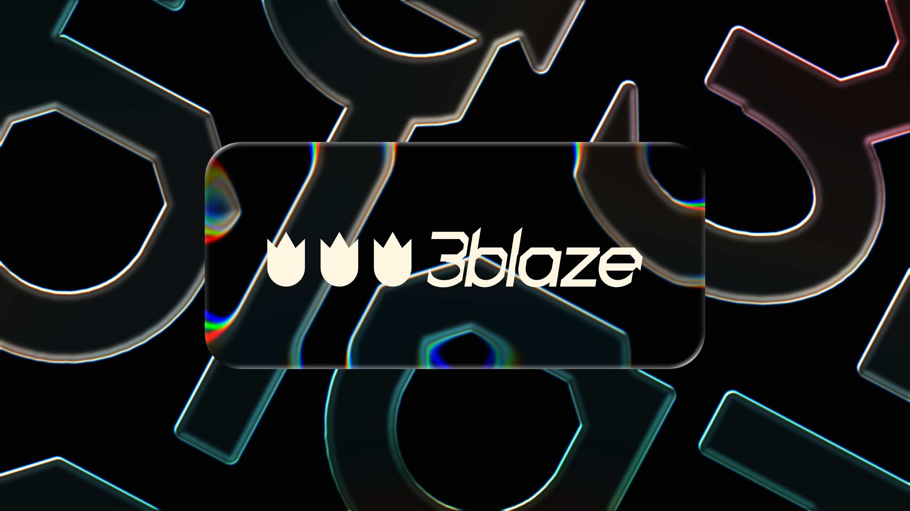
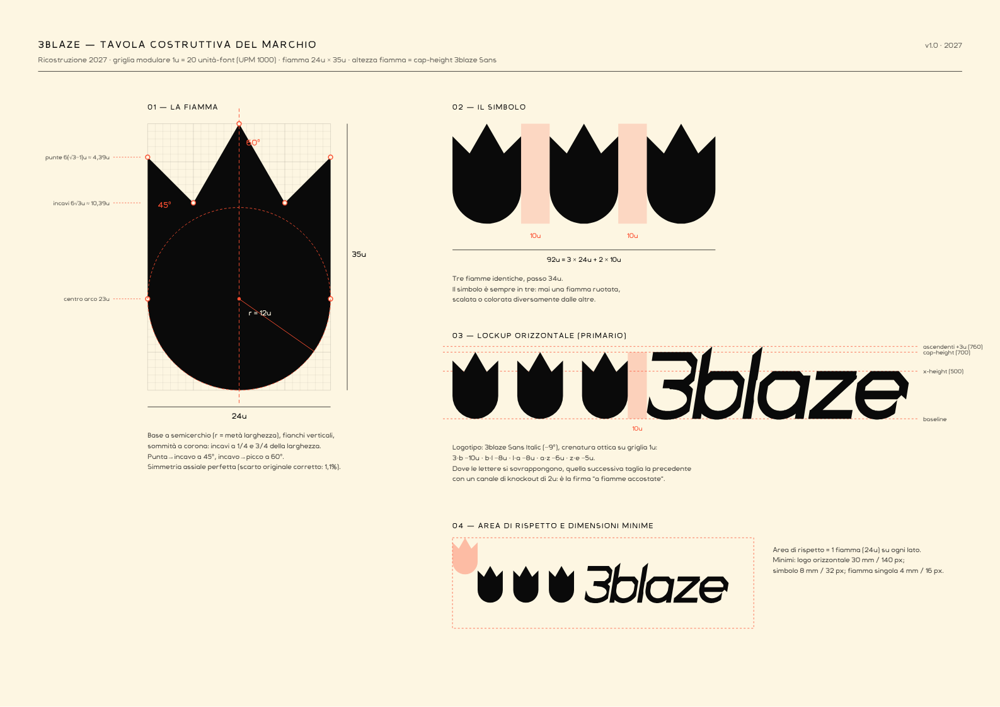
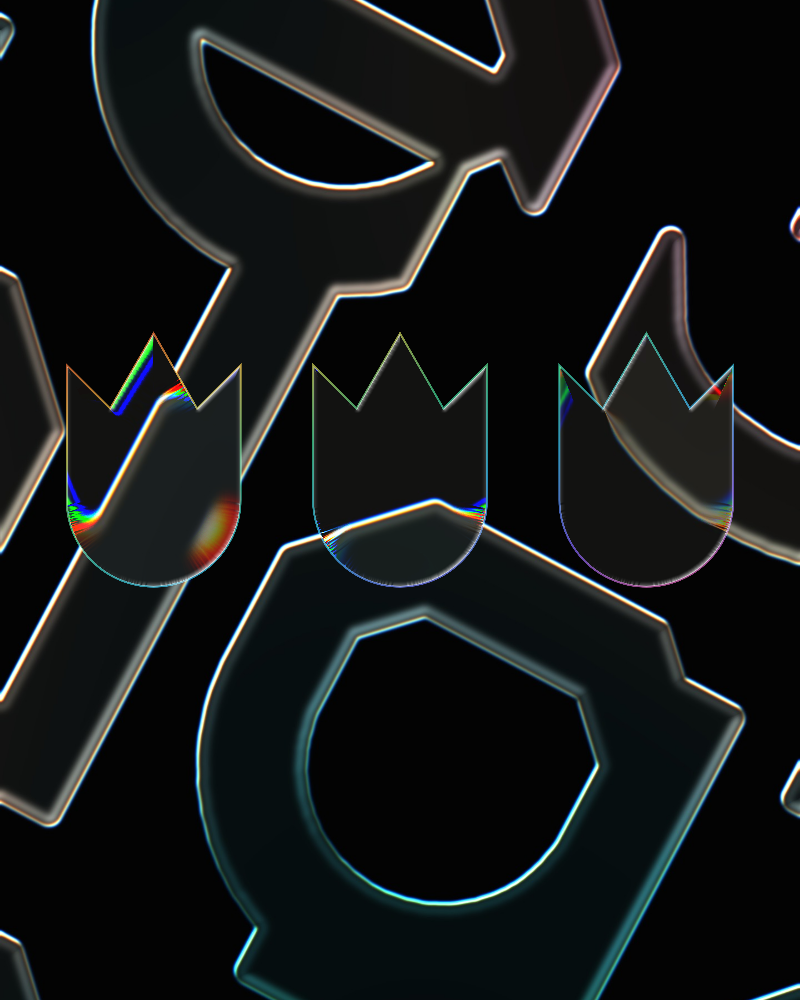
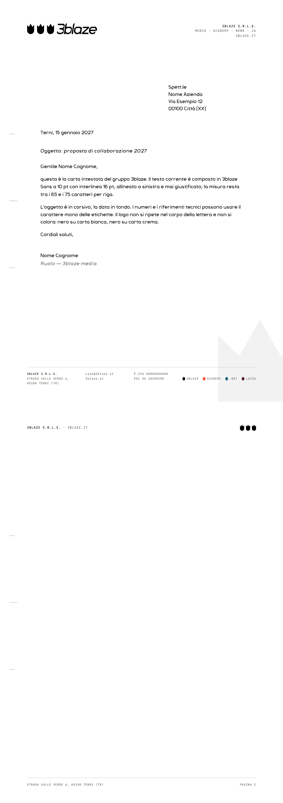
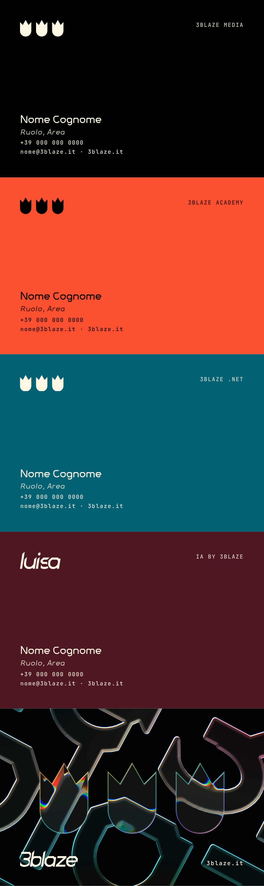
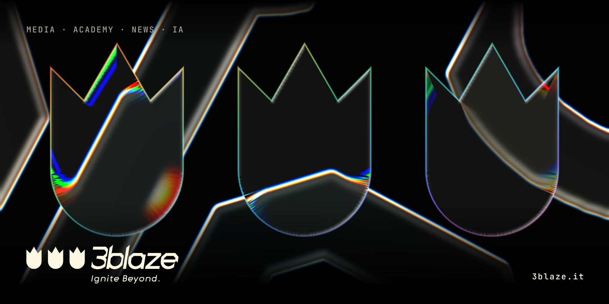
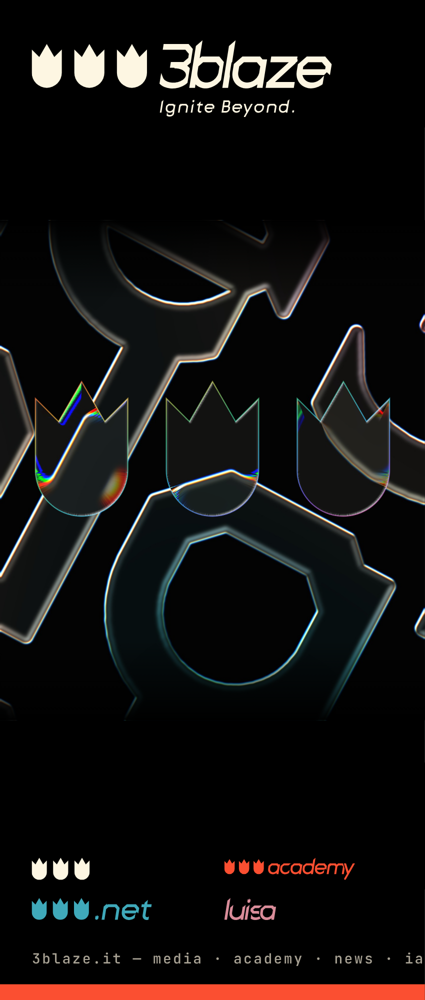
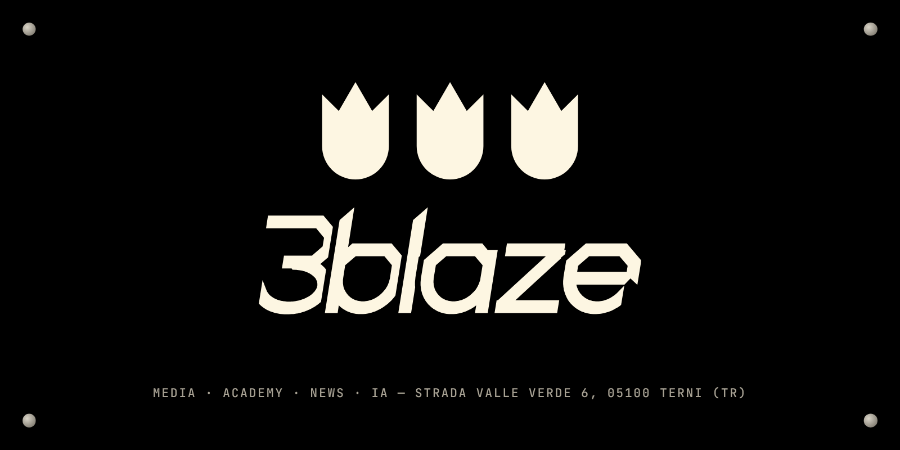
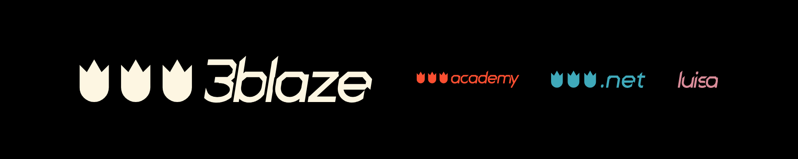
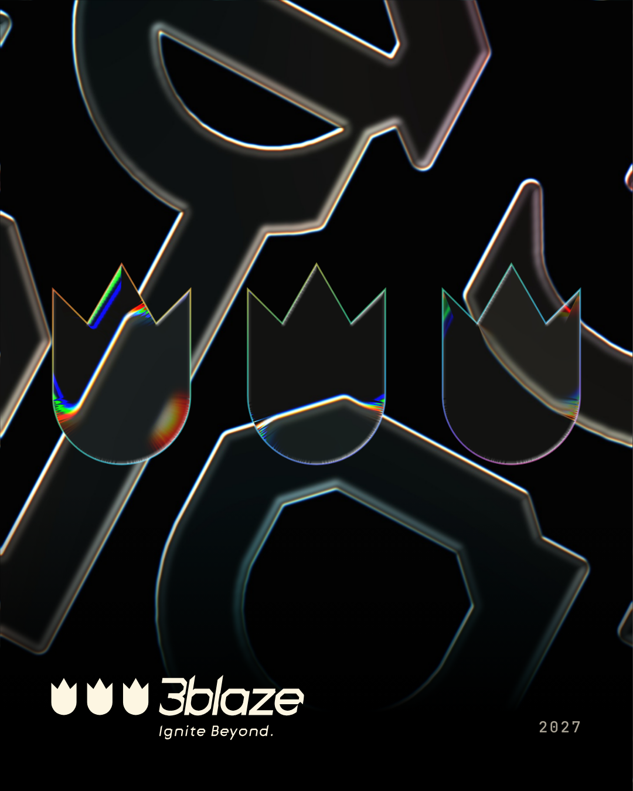

# 3blaze — Brand System 2027

> **Spigoli in alto, curve in basso. Come il fuoco.**
> Il sistema d'identità della holding 3blaze e delle sue divisioni: media, academy, .net (news) e luisa (IA). Questo documento è scritto per essere letto allo stesso modo da persone e da intelligenze artificiali: ogni regola ha un valore, un token o un file a cui riferirsi.



## 1. Chi siamo, in una riga per divisione

| Divisione | Nome nel marchio | Colore (token) | Ruolo |
|---|---|---|---|
| Holding / media | **3blaze** | Nero `--brand-nero` #000000 | Strategia, contenuti, produzione video, brand management. È anche la voce del gruppo. |
| Formazione | **3blaze academy** | Brace `--academy` #FB4F31 | Corsi, workshop, percorsi per aziende e scuole. |
| News | **3blaze .net** | Petrolio `--news` #006172 | Informazione, rubriche, matchday e territorio. |
| Intelligenza artificiale | **luisa** | Vinaccia `--ia` #4D1821 | L'assistente IA proprietaria del gruppo. Unico marchio senza le tre fiamme: la fiamma è il punto della *i*. |

Il Crema `--brand-crema` #FDF6E2 è il "bianco" di tutto il gruppo: logo, testo su fondi scuri, carta. Il bianco puro #FFFFFF non è un colore del brand (si accetta solo come carta da ufficio).

## 2. Le cinque regole non negoziabili

1. **Il marchio non si ridisegna.** Si usano solo i file SVG di `assets/Logo/`. Niente testo "3blaze" scritto a mano con il font al posto del logotipo: il logotipo ha crenature e tagli di knockout che il font da solo non ha.
2. **Una divisione, un colore.** Ogni materiale ha un colore di divisione dominante (fondo o logo) e al massimo un accento: la Brace. Mai due colori di divisione come fondi nella stessa superficie, salvo i materiali di gruppo (holding) che li elencano tutti.
3. **Due caratteri, ruoli fissi.** *3blaze Sans* per tutto. *3blaze Display* solo per titoli grandi (≥ 48 px / ≥ 18 pt), in maiuscolo o in frasi di massimo 4 parole. Il mono (JetBrains Mono) è lo strato "codice": etichette, numerazioni, metadati.
4. **Il vetro è vero o non c'è.** Il liquid glass 3blaze è rifrazione reale con bordo arcobaleno (vedi *Liquid Glass*). Un `backdrop-filter: blur()` da solo non è il nostro vetro: è il fallback, e si dichiara come tale.
5. **Spigoli in alto, curve in basso.** È la forma della fiamma e diventa la regola di layout: tagli netti e allineamenti duri in alto, archi e raggi pieni in basso (bottoni a pillola, foto con base arrotondata, card con raggio pieno solo sotto).

## 3. Mappa del sistema

| Sezione | Cosa contiene |
|---|---|
| **Marchio** | Geometria ricostruita (griglia 1u), versioni, area di rispetto, dimensioni minime, usi scorretti, sub-brand. |
| **Colore** | Palette, abbinamenti per settore, contrasti verificati WCAG, proporzioni. |
| **Tipografia** | 3blaze Sans, 3blaze Display, mono; scala, regole, CSS pronto. |
| **Liquid Glass** | Il vetro rifrangente con bordo arcobaleno: principio, parametri, codice, quando usarlo. |
| **Layout e immagini** | Griglia, spaziature, motivo "spigoli/curve", fotografia, iconografia. |
| **Stampati** | Carta intestata, biglietti da visita, busta, firma email: misure e file. |
| **Cartellonistica e social** | Roll-up, affissione 6×3, targa, insegna, avatar, cover, post. |
| **Voce** | Tono, il claim Ignite Beyond, parole da evitare. |
| **Per le IA** | Specifica compatta in YAML, prompt-base per generare immagini e layout, checklist di verifica. |

## 4. Come si usa questo sistema

- **Designer**: scaricate SVG e PDF da *Assets*; i colori e i caratteri sono in *Tokens* e *Typography*.
- **Sviluppatori**: `codice/tokens.css` espone tutte le variabili; `codice/liquid-glass.js` espone `window.LiquidGlass`; `codice/3blaze-components.css` contiene le classi `.lg`, `.btn`, `.tag`, `.flame-frame`.
- **IA (LLM, agenti, generatori di immagini)**: leggete prima questa pagina, poi la sezione *Per le IA*. Usate i nomi dei token, mai valori inventati. Se una regola non copre il caso, scegliete la soluzione più sobria: fondo Nero o Crema, un solo accento Brace.

## 5. Origine e versioni

- Ricostruzione del marchio: novembre 2026, a partire dal lettering *3blaze Sans v0.2*, dal font *3blaze Display* e dalla tavola di rebranding con la palette per settore.
- Modifiche rispetto al marchio precedente: fiamma resa perfettamente simmetrica (scarto dell'originale 1,1%), angoli normalizzati a 45° e 60°, altezza della fiamma agganciata alla cap-height del Sans (700/1000), spaziature su griglia di 1u = 20 unità.
- Dati societari da completare prima della stampa: **P.IVA, PEC, telefono** (nei file compaiono come segnaposto).


# Marchio



## La fiamma: geometria esatta

Unità di griglia **1u = 20 unità-font** (il 3blaze Sans ha UPM 1000). La fiamma occupa **24u × 35u**: la sua altezza (700) coincide con la cap-height del 3blaze Sans, così simbolo e logotipo condividono la stessa linea di base e la stessa linea delle maiuscole.

| Elemento | Valore | Note |
|---|---|---|
| Larghezza | 24u (480) | |
| Altezza | 35u (700) | = cap-height 3blaze Sans |
| Picco centrale | (12u, 0) | asse di simmetria |
| Incavi | x = 6u e 18u, y = 6√3u ≈ 10,39u | incavo→picco a **60°** |
| Punte laterali | x = 0 e 24u, y = 6(√3−1)u ≈ 4,39u | punta→incavo a **45°** |
| Fianchi | verticali, da 4,39u a 23u | |
| Base | semicerchio r = 12u, centro (12u, 23u) | |

Path SVG di riferimento (viewBox `0 0 480 700`):

```
M0 87.85 L120 207.85 L240 0 L360 207.85 L480 87.85 L480 460 A240 240 0 0 1 0 460 Z
```

## Il simbolo

Tre fiamme identiche, **spazio tra le fiamme 10u (200)**, larghezza totale **92u (1840 × 700)**. Le tre fiamme stanno sempre insieme, alla stessa scala e nello stesso colore.

## Il logotipo

"3blaze" composto in **3blaze Sans Italic** (inclinazione −9°) con crenatura ottica su griglia di 1u:

| Coppia | 3·b | b·l | l·a | a·z | z·e |
|---|---|---|---|---|---|
| Crenatura | −10u | −8u | −8u | −6u | −5u |

Dove due lettere si toccano, la lettera successiva taglia la precedente con un **canale di knockout di 2u**: è la firma visiva del logotipo ("fiamme accostate"). Per questo il logotipo non va mai riscritto con il font: va usato il file.

## Versioni

| File | Uso |
|---|---|
| `3blaze_logo_horizontal_*` | **Primaria.** Simbolo + logotipo, spazio 10u, fondo fiamma = linea di base. |
| `3blaze_logo_stacked_*` | Spazi verticali o quadrati (targhe, avatar grandi, copertine). |
| `3blaze_symbol_*` | Avatar, favicon grandi, timbri, ricamo, pattern. |
| `3blaze_flame_*` | Favicon 16–32 px, punto elenco, separatore, segno di chiusura. |
| `3blaze_wordmark_*` | Dove il simbolo è già presente nella stessa vista. |
| `3blaze_academy_*`, `3blaze_net_*` | Sub-brand con simbolo. |
| `luisa_*` | Sub-brand IA: solo logotipo; la fiamma è il punto della *i*. |
| `3blaze_logo_claim_*` | Marchio con la firma *Ignite Beyond.* (vedi Voce). |
| `3blaze_claim_*` | Il claim da solo, per le chiusure di video e slide. |

Colori disponibili per ogni file: `_black` (#000000), `_cream` (#FDF6E2), più il colore della divisione per i sub-brand (`_orange`, `_teal`, `_wine`). I file senza suffisso usano `currentColor` e prendono il colore del testo.

## Area di rispetto e dimensioni minime

- **Area di rispetto**: una fiamma intera (24u, cioè la larghezza di una fiamma alla scala d'uso) su ogni lato.
- **Minimi**: logo orizzontale 30 mm / 140 px · logo verticale 18 mm / 90 px · simbolo 8 mm / 32 px · fiamma singola 4 mm / 16 px.

## Abbinamenti logo / fondo ammessi

| Fondo | Logo |
|---|---|
| Nero | Crema |
| Crema o carta bianca | Nero |
| Brace (academy) | Nero oppure Crema (solo ≥ 30 mm) |
| Petrolio (.net) | Crema |
| Vinaccia (luisa) | Crema |
| Foto | Crema su zona scura, Nero su zona chiara; altrimenti su pannello liquid glass |

## Usi scorretti

- Ridisegnare, ricomporre o riscrivere il logotipo con il font.
- Ruotare, deformare, aggiungere contorni, ombre, rilievi o gradienti al marchio.
- Cambiare il numero, l'ordine o la spaziatura delle fiamme; colorare le tre fiamme diversamente.
- Usare il colore di una divisione per il logo di un'altra.
- Mettere il logo su fondi con contrasto inferiore a 3:1.
- Applicare il liquid glass *al* logo: il vetro sta sotto il logo, mai dentro le sue forme.


# Colore

Il gruppo vive su due fondi, **Nero** e **Crema**. Ogni divisione aggiunge il proprio colore pieno. La Brace è anche l'accento di tutto il gruppo: è la fiamma.

## Palette istituzionale

| Nome | Token | HEX | RGB | CMYK (indicativo, da verificare con prova colore) | Divisione |
|---|---|---|---|---|---|
| Nero | `--brand-nero` | #000000 | 0 0 0 | 60 40 40 100 (nero ricco) | 3blaze / media / holding |
| Crema | `--brand-crema` | #FDF6E2 | 253 246 226 | 0 2 10 0 | tutto il gruppo |
| Brace | `--academy` | #FB4F31 | 251 79 49 | 0 80 85 0 | academy · accento di gruppo |
| Petrolio | `--news` | #006172 | 0 97 114 | 95 40 35 25 | .net (news) |
| Vinaccia | `--ia` | #4D1821 | 77 24 33 | 35 90 65 60 | luisa (IA) |

Le conversioni CMYK e Pantone vanno fissate con lo stampatore sulla carta scelta: i valori qui sopra sono punti di partenza, non specifiche finali.

## Abbinamenti per settore

| Divisione | Fondo | Testo / logo | Accento ammesso |
|---|---|---|---|
| 3blaze (media, holding) | Nero | Crema | Brace (un elemento) |
| 3blaze academy | Brace | Nero (testi piccoli) · Crema (≥ 24 px) | Nero |
| 3blaze .net | Petrolio | Crema | Brace per "live"/"ultim'ora" |
| luisa | Vinaccia | Crema | nessuno: il bordo arcobaleno del vetro fa da accento |

## Contrasti verificati (WCAG 2.2)

| Coppia | Rapporto | Uso consentito |
|---|---|---|
| Crema su Nero | 19,5:1 | tutto |
| Nero su Brace | 6,3:1 | tutto |
| Crema su Brace | 3,1:1 | solo testo ≥ 24 px e logo ≥ 30 mm |
| Crema su Petrolio | 6,6:1 | tutto |
| Crema su Vinaccia | 13,3:1 | tutto |
| Brace su Crema | 3,1:1 | solo titoli ≥ 24 px; per testo piccolo usare `--academy-ink` #C93A20 (4,7:1) |
| Petrolio su Nero | 2,9:1 | **mai per testo**: usare `--news-ink` #3FA9BA (7,6:1) |
| Vinaccia su Nero | 1,5:1 | **mai**: usare `--ia-ink` #D98C99 (8,2:1) |
| `--ink-muted` su ground | 5,3:1 (crema) · 8,3:1 (nero) | testo secondario |

## Proporzioni

Su una superficie tipica: **70% fondo** (Nero o Crema), **20% colore di divisione**, **≤ 10% Brace**. La Brace non fa mai da fondo di una pagina della holding: è un segnale, non un ambiente.

## Il Prisma (solo per il vetro)

`--prism-1…6` (#FF4F31 · #FFD23F · #3DDC97 · #2EC4FF · #7B61FF · #FF5FA2) esistono solo come dispersione del liquid glass e del suo bordo. Non sono colori del brand: mai fondi, mai testo, mai icone, mai gradienti decorativi.

## Temi digitali

`data-theme="dark"` (primario, fondo Nero) e `data-theme="light"` (fondo Crema). Tutti i token `*-ink`, `ground`, `surface-*`, `ink*` cambiano valore per tema; i colori di divisione restano fissi.


# Tipografia

## I caratteri

| Carattere | File | Ruolo |
|---|---|---|
| **3blaze Sans** (500, tondo e corsivo) | `fonts/3blazeSans-Regular.woff2`, `fonts/3blazeSans-Italic.woff2` | **Carattere principale.** Titoli fino a 48 px, testo, interfacce, documenti. Ogni lettera segue la fiamma: base a semicerchio, fianchi dritti, sommità smussate a 45°; il punto della *i* e della *j* è una fiamma. |
| **3blaze Display** (400) | `fonts/3blazeDisplay-Regular.woff2` | **Solo titoli grandi.** Pesante, inclinato (−12°), con retino a mezzatinta incorporato nel disegno. Mai sotto 48 px / 18 pt. |
| **JetBrains Mono** (400, 500) | `fonts/JetBrainsMono-*.woff2` (OFL) | Lo strato "codice": etichette in maiuscolo, numerazioni, metadati, snippet. Mai per frasi. |

> Nel CSS i nomi dei font vanno **sempre tra virgolette**: `font-family: '3blaze Sans'`. Un nome che inizia con una cifra senza virgolette è CSS non valido e il browser lo ignora in silenzio.

## Scala

| Stile | Carattere | Corpo / interlinea | Uso |
|---|---|---|---|
| `display-xl` | Display | 160 / 0,92 | manifesti, hero |
| `display-l` | Display | 112 / 0,95 | apertura di sezione |
| `display-m` | Display | 72 / 1,0 | numeri chiave, slide (minimo assoluto 48) |
| `headline-l` | Sans | 48 / 1,05, −0,02em | H1 |
| `headline-m` | Sans | 32 / 1,15, −0,01em | H2 |
| `title` · `title-italic` | Sans | 24 / 1,25 | H3, occhielli in corsivo |
| `body-l` | Sans | 19 / 1,55 | lead |
| `body` | Sans | 16 / 1,6 | testo corrente, misura 60–72 caratteri |
| `small` | Sans | 14 / 1,5 | note, form |
| `caption` | Sans corsivo | 13 / 1,45 | didascalie |
| `label` | Mono 500 | 12 / 1,3, +0,12em, MAIUSCOLO | etichette, numerazioni "01 —" |
| `code` | Mono 400 | 14 / 1,55 | codice, dati |

In stampa: testo corrente 9,5–10 pt, didascalie 7,5 pt, etichette mono 6–7 pt.

## Regole

- **Un solo peso.** Entrambi i caratteri del brand hanno un peso: la gerarchia si fa con corpo, corsivo, colore e spazio, mai con il grassetto sintetico (`font-weight: 700` è vietato).
- **Corsivo = voce.** Il corsivo del Sans porta occhielli, citazioni, oggetti di lettera, il nome di luisa.
- **Display in breve.** Massimo 4 parole o un numero; maiuscolo consigliato (numeri di sezione, cifre chiave, nomi di divisione). Il claim *Ignite Beyond.* non si compone mai in Display.
- **Effetto blur del Display.** Facoltativo, solo sul web e solo ≥ 48 px: `filter: blur(0.009em)` (più morbido 0.012em, più nitido 0.006em).
- **Allineamento** a sinistra, mai giustificato; niente sillabazione nei titoli.
- **Numeri** nel Sans; le cifre del Display solo per numeri-titolo.

## CSS minimo

```css
@font-face { font-family: '3blaze Sans'; src: url(fonts/3blazeSans-Regular.woff2) format('woff2'); font-weight: 500; font-display: swap; }
@font-face { font-family: '3blaze Sans'; src: url(fonts/3blazeSans-Italic.woff2) format('woff2'); font-weight: 500; font-style: italic; font-display: swap; }
@font-face { font-family: '3blaze Display'; src: url(fonts/3blazeDisplay-Regular.woff2) format('woff2'); font-display: swap; }
body { font-family: '3blaze Sans', Futura, system-ui, sans-serif; font-weight: 500; }
.display { font-family: '3blaze Display', '3blaze Sans', sans-serif; font-weight: 400; line-height: .95; }
```


# Liquid Glass



## Il principio

Il vetro 3blaze è **una lente, non una nebbia**. Un pannello di vetro spesso con il bordo convesso: al centro lo sfondo si vede quasi intatto, verso il bordo viene piegato e compresso, e sul filo del bordo la luce si scompone nei colori del prisma. È il "bordo arcobaleno", più intenso negli angoli dove la curvatura è massima.

| Vetro finto (vietato come stile) | Vetro 3blaze |
|---|---|
| `backdrop-filter: blur(24px)` + bordo bianco 1px | rifrazione reale con `feDisplacementMap` |
| sfoca e basta: lo sfondo "si spalma" | piega lo sfondo: le righe si curvano verso il bordo |
| bordo bianco uniforme | dispersione R/G/B: frange arcobaleno sugli angoli |
| funziona su qualunque fondo | ha senso solo sopra contenuto con contrasto (tipografia, foto) |

## Come funziona (spiegato per chi lo deve rifare)

1. Si genera una **mappa di spostamento** grande quanto il pannello: per ogni pixel si calcola la distanza dal bordo e la normale della forma (rettangolo arrotondato in forma analitica; forme libere, come la fiamma, con una trasformata di distanza esatta).
2. Nella fascia del bordo (`--glass-bezel`, 40 px di default) l'intensità segue un profilo di lente convessa: massima sul filo, che svanisce verso l'interno. La direzione punta verso l'interno: il bordo comprime lo sfondo.
3. Il filtro SVG applica la mappa **tre volte**, una per canale: rosso a `scale × (1 − 0,22)`, verde a `scale`, blu a `scale × (1 + 0,22)`. I tre canali spostati di quantità diverse si ricompongono e dove lo spostamento è forte nasce l'arcobaleno.
4. Sopra: una luce speculare radente (alto-sinistra) solo sul filo del bordo, un velo `--glass-tint`, l'ombra `--shadow-glass`, e per i pannelli rettangolari un filetto iridescente al 55% in `screen`.

## Parametri (token)

| Token | Default | Effetto |
|---|---|---|
| `--glass-bezel` | 40px | larghezza della fascia che rifrange |
| `--glass-refraction` | 70 | quanto viene spostato lo sfondo |
| `--glass-dispersion` | 0.22 | separazione dei canali → intensità dell'arcobaleno |
| `--glass-blur` | 1.2px | ammorbidisce solo i dettagli finissimi |
| `--radius-lg` / `--radius-xl` | 32 / 48px | raggio dei pannelli |

Hero e manifesti: bezel 56–70, refraction 80–110. Interfacce: bezel 28–40, refraction 50–70.

## Codice

```html
<link rel="stylesheet" href="components/bundle.css">
<script src="components/bundle.js"></script>

<!-- pannello rettangolare -->
<div data-lg data-lg-radius="32" data-lg-bezel="40" data-lg-scale="70">…contenuto…</div>

<!-- fiamma di vetro (forma libera); per le tre fiamme usare il path del simbolo 3blaze_symbol -->
<div style="width:240px;height:350px" data-lg data-lg-bezel="40" data-lg-scale="90"
     data-lg-viewbox="0 0 480 700"
     data-lg-path="M0 87.85 L120 207.85 L240 0 L360 207.85 L480 87.85 L480 460 A240 240 0 0 1 0 460 Z"></div>

<script> Blaze.LiquidGlass.attach(el, { radius: 32, bezel: 40, scale: 70, dispersion: .22 }); </script>
```

## Compatibilità

- **Chromium** (Chrome, Edge, Arc, Opera, Brave): rifrazione completa via `backdrop-filter: url(#filtro)`.
- **Safari e Firefox**: la libreria passa da sola al fallback `.lg--fallback` (vetro sfocato + filetto iridescente). È accettabile, ma non è il riferimento del brand.
- **Stampa, video, social**: il vetro si usa come immagine renderizzata (le scene *Prisma* in *Assets / Liquid Glass*), mai ricreato con effetti "glass" dei programmi di impaginazione.
- `prefers-reduced-transparency`: il pannello diventa opaco `--surface-2`.

## Quando usarlo

- **Sì**: sopra tipografia Display in movimento, foto, video; per un solo elemento protagonista per vista (hero, player, card di prezzo, avatar).
- **No**: su fondo piatto (non c'è niente da rifrangere), per tutti i componenti di una pagina, sotto testo lungo, sopra il logo o dentro le sue forme.
- **Testo sul vetro**: sempre Crema su vetro sopra fondo scuro, con ombra di sicurezza `0 1px 2px #0008`; verificare il contrasto sul punto peggiore dello sfondo.


# Layout e immagini

## Il motivo: spigoli in alto, curve in basso

La fiamma è un'unica idea formale e il layout la ripete:

- **In alto, spigoli**: tagli netti, testate allineate a filo, etichette mono, filetti orizzontali (`--hairline`) che dividono le righe tipografiche come nella scena *Prisma*.
- **In basso, curve**: bottoni a pillola (`--radius-pill`), immagini e card con raggio pieno solo sugli angoli inferiori (classe `.flame-frame`), chiusure di pagina morbide.

```css
.flame-frame { border-radius: 0 0 var(--radius-xl) var(--radius-xl); overflow: hidden; }
```

## Griglia

| Formato | Colonne | Margine | Gutter |
|---|---|---|---|
| Desktop ≥ 1200 px | 12 | `--space-24` (96) | `--space-8` (32) |
| Tablet | 8 | `--space-16` (64) | `--space-6` (24) |
| Mobile | 4 | `--space-6` (24) | `--space-4` (16) |
| A4 stampa | 12 su 170 mm | 20 mm laterali, 17 mm testa | 4 mm |

Le spaziature seguono la scala da 4 px (`--space-1` … `--space-32`). Tra blocchi: `--space-12`; tra sezioni: `--space-24`.

## La scena Prisma

Lo sfondo-firma del gruppo è la **Trama Vetro**: la parola **3blaze** fatta di vetro scuro, fuori scala, ruotata di 28° e ripetuta in righe che si incastrano, su Nero. Come negli sfondi Apple (MacBook Neo, MacBook Pro) la scritta non si dichiara: si scopre; restano solo frammenti. I colori del brand (Brace, rosa vinaccia, Crema, Petrolio) vivono solo sul filo dei bordi, come dispersione del vetro; il corpo resta quasi nero. Solo su Nero, mai sul tema Crema. File: `trama/3blaze_trama_vetro_*.jpg` (16:9, 9:16, 1:1, A4).

Sopra la trama vive un solo oggetto di vetro: **le tre fiamme di vetro** (il simbolo, con rifrazione e bordo arcobaleno), un pannello con il marchio o i controlli di un'interfaccia. La trama non sostituisce mai il marchio: dove compare la scena, il marchio pieno è comunque presente una volta.

## Fotografia

- Luce vera, contrasto alto, neri profondi: le foto devono reggere il fondo Nero.
- Persone al lavoro, mani, set, backstage, campi da gioco, aule: mai foto di stock in posa.
- Tagli decisi, soggetto decentrato; base arrotondata con `.flame-frame` quando la foto è un riquadro.
- Nessun filtro colorato di divisione sopra le foto: il colore di divisione sta intorno, non sopra.

## Iconografia

- Tratto 1,5 px su griglia 24, terminali squadrati, angoli superiori vivi e inferiori arrotondati (come la fiamma).
- Monocromatiche in `--ink`; mai icone colorate o emoji nei materiali istituzionali.
- La fiamma singola (`3blaze_flame`) sostituisce il punto elenco nelle liste di brand e chiude gli articoli di .net.

## Movimento

Durate `160ms` (hover), `280ms` (pannelli), `600ms` (hero); easing `cubic-bezier(.2,.8,.2,1)`. Il vetro si muove lento sopra righe che scorrono in orizzontale a velocità diverse; nessun rimbalzo, nessuna rotazione del marchio.


# Stampati

Tutti i file sono PDF vettoriali con i font incorporati (in *Assets / Stampati*). Prima di andare in stampa: inserire **P.IVA, PEC e telefono** (oggi segnaposto), convertire i colori con lo stampatore, chiedere una prova colore della Brace.

## Carta intestata A4



| Elemento | Specifica |
|---|---|
| Formato | 210 × 297 mm, due versioni: **bianco** (stampa da ufficio) e **crema** (PDF digitale o carta tinta crema) |
| Logo | orizzontale nero, 52 mm, a 20 mm dal margine sinistro e 17 mm dall'alto |
| Dati in testa | mono 6,6 pt maiuscolo, allineati a destra: ragione sociale, divisioni, sito |
| Corpo | 3blaze Sans 10/16 pt, margini 30 mm, destinatario a 125 mm dal bordo sinistro (finestra busta) |
| Oggetto | corsivo |
| Piede | mono 5,9 pt su quattro colonne: sede · contatti · P.IVA/PEC · le quattro divisioni con la fiamma nel loro colore |
| Segni | piega a 99 e 198 mm, foratura a 148,5 mm |
| Seconda pagina | simbolo 12 mm in alto a destra, ragione sociale in alto a sinistra, piede ridotto |
| Firma visiva | una fiamma al 5% tagliata nell'angolo in basso a destra |

## Biglietto da visita



| Elemento | Specifica |
|---|---|
| Formato | 85 × 55 mm, abbondanza 3 mm per lato (file a 91 × 61 mm), area sicura 4 mm |
| Fronte | fondo nel colore della divisione: Nero (media), Brace (academy, inchiostro nero), Petrolio (.net), Vinaccia (luisa) |
| Contenuto fronte | simbolo 15 mm in alto a sinistra (luisa: logotipo); divisione in mono in alto a destra; nome Sans 10 pt, ruolo corsivo 7 pt, contatti mono 5,4 pt |
| Retro | comune a tutte le divisioni: scena Prisma con le tre fiamme di vetro, logotipo crema 20 mm, `3blaze.it` |
| Carta consigliata | 400–600 g/m² uncoated, retro in stampa digitale HD o offset; per la holding valutare il fronte a caldo crema su cartoncino nero colorato in pasta |

## Busta DL

220 × 110 mm, bianca. Logo orizzontale 42 mm a 12/11 mm dal bordo; mittente in mono 6 pt; quattro fiamme delle divisioni in basso a sinistra; finestra 90 × 45 mm a 110/50 mm (allineata al destinatario della carta intestata).

## Firma email

File `firma_email.html` (nella cartella del progetto). Logo PNG @2x largo 132 px ospitato su `3blaze.it/brand/`, nome Sans 14 px, ruolo corsivo, contatti in mono 11 px, link al sito in `--academy-ink`, riga delle divisioni con quadratini colorati. Niente immagini di sfondo, niente banner.

## Altri materiali da derivare con le stesse regole

Cartellina A4 (Nero, simbolo e marchio con claim in Crema, scena Prisma all'interno) · badge eventi (fondo divisione, ruolo in Display) · timbro (simbolo + ragione sociale in mono).


# Cartellonistica e social

I file di grande formato sono impaginati **in scala** (indicata nel nome) e sono vettoriali tranne la scena di vetro, che è un'immagine renderizzata: a scala reale corrisponde a circa 30 dpi sull'affissione e 75 dpi sul roll-up, sufficienti alla distanza di lettura. Per una risoluzione superiore si rigenera la scena con `build_scene.py` alla dimensione richiesta.

## Affissione 6 × 3 m (scala 1:10)



Nessun titolo: le tre fiamme di vetro sulla scena Prisma occupano il formato, il marchio con il claim *Ignite Beyond.* firma in basso a sinistra, `3blaze.it` in mono in basso a destra. Per una campagna di divisione si aggiunge un solo messaggio breve in 3blaze Sans.

## Roll-up 85 × 200 cm (scala 1:4)



Dall'alto: marchio con claim (sempre sopra i 160 cm, visibile oltre la folla) → scena Prisma con le tre fiamme di vetro → i quattro marchi di divisione → sito → fascia Brace di 8 cm a terra (zona che finisce nella base del roll-up, nessun contenuto).

## Targa d'ingresso 40 × 20 cm



Plexiglass nero lucido 8 mm, logo verticale stampato UV crema (o inciso e laccato), riga mono con le divisioni e l'indirizzo, quattro distanziali in acciaio satinato.

## Insegna a cassonetto 300 × 60 cm (scala 1:10)



Fondo nero opaco, logo orizzontale crema retroilluminato (lettere scatolate o pellicola su plexi opalino), marchi di divisione nei loro colori chiari a destra. Di notte il Crema deve restare caldo: LED 3000 K.

## Social

| Formato | Misure | Regola |
|---|---|---|
| Avatar | 1080 × 1080 | simbolo crema su Nero, centrato, area di rispetto per il ritaglio circolare. Divisioni: fondo nel proprio colore. |
| Cover LinkedIn | 1584 × 396 | scena Prisma, pannello di vetro con il logo nel terzo destro (a sinistra c'è la foto profilo). |
| Post 4:5 | 1080 × 1350 | scena con le tre fiamme di vetro, marchio con claim in basso, etichetta mono. |
| Story / Reel | 1080 × 1920 | aree sicure: 250 px in alto, 340 px in basso; headline sopra la metà. |




# Voce

## Come parla 3blaze

- **Diretta.** Frasi brevi, verbi attivi, la cosa più importante per prima.
- **Concreta.** Numeri, tempi, nomi: "consegna in 3 settimane", non "tempi rapidi".
- **Calda, non urlata.** Il fuoco scalda prima di bruciare: niente maiuscole gridate nel testo corrente, niente punti esclamativi a raffica.
- **Tecnica quando serve.** Lo strato mono esiste per i dati: non si nasconde la complessità, la si ordina.
- **Italiano prima.** L'inglese solo per nomi di prodotto e termini senza equivalente (es. "reel", "matchday").

## Il claim: Ignite Beyond.

> *Ignite Beyond.* — accendi l'oltre.

Dice cosa fa il gruppo per chi lavora con lui: accendere un'idea e portarla più in là di dove sarebbe arrivata da sola. **Non è il protagonista**: come *Think different.* per Apple, è una firma che si legge per ultima e resta.

- **Dove**: sotto il marchio (file `3blaze_logo_claim`), in chiusura di video e presentazioni (`3blaze_claim`), in fondo a un'affissione o a un sito. Una sola volta per materiale.
- **Come**: 3blaze Sans Italic, maiuscole iniziali, punto finale, nello stesso colore del marchio. Altezza delle maiuscole pari al 28% della fiamma del marchio che accompagna.
- **Mai**: come titolo, in 3blaze Display, tutto maiuscolo, con il punto esclamativo, in un colore diverso dal marchio, tradotto nei materiali. *Accendi l'oltre* serve solo a spiegarlo.

## Frasi di divisione (proposte, subordinate al claim)

| Divisione | Claim | Uso |
|---|---|---|
| 3blaze media | Contenuti che restano accesi. | presentazioni, sito |
| 3blaze academy | Si impara facendo fuoco. | corsi, aule, badge |
| 3blaze .net | Notizie dal campo. | testata, social |
| luisa | L'intelligenza di casa. | prodotto, onboarding |

## Parole da evitare

"leader del settore", "a 360 gradi", "qualità garantita", "soluzioni innovative", "eccellenza", "make communication great again" e "Brucia l'ovvio" (claim precedenti, ritirati).

## Scrittura dei nomi

- **3blaze** sempre minuscolo, anche a inizio frase. Mai "3Blaze", "3 Blaze", "Treblaze".
- **3blaze academy**, **3blaze .net** (con lo spazio prima del punto), **luisa** (minuscolo).
- Nei testi legali: **3BLAZE S.R.L.S.**


# Per le IA

Questa sezione riassume il sistema in forma compatta per modelli linguistici, agenti di sviluppo e generatori di immagini. In caso di conflitto valgono le sezioni precedenti; i valori esatti stanno in `tokens.json`.

## Specifica compatta

```yaml
brand: 3blaze
type: holding (media, formazione, news, intelligenza artificiale)
location: Terni, Italia
version: 2027.1
divisions:
  - {id: media,   name: "3blaze",          color: "#000000", logo: 3blaze_logo_horizontal}
  - {id: academy, name: "3blaze academy",  color: "#FB4F31", logo: 3blaze_academy, ink_on_color: "#000000"}
  - {id: news,    name: "3blaze .net",     color: "#006172", logo: 3blaze_net,     ink_on_color: "#FDF6E2"}
  - {id: ia,      name: "luisa",           color: "#4D1821", logo: luisa,          ink_on_color: "#FDF6E2"}
neutrals: {nero: "#000000", crema: "#FDF6E2"}   # crema sostituisce il bianco
accent: "#FB4F31"                                # brace, max 10% della superficie
text_on_dark: {news: "#3FA9BA", ia: "#D98C99", muted: "#A8A294"}
text_on_light: {academy: "#C93A20", muted: "#6B665C"}
fonts:
  primary: {family: "3blaze Sans", weight: 500, styles: [normal, italic], use: "tutto"}
  display: {family: "3blaze Display", weight: 400, min_size_px: 48, use: "solo titoli grandi, max 4 parole"}
  mono:    {family: "JetBrains Mono", weight: [400, 500], use: "etichette maiuscole +0.12em, dati"}
logo:
  geometry: {unit: "1u = 20/1000 em", flame: "24u x 35u", flame_height: "= cap-height Sans (700)", gap: "10u", angles: [45, 60], base: "semicerchio r=12u"}
  never: [ridisegnare, riscrivere col font, ruotare, ombre, contorni, gradienti, colori di altre divisioni, vetro dentro il logo]
  clear_space: "1 larghezza di fiamma"
  min_size: {horizontal: "30mm/140px", symbol: "8mm/32px", flame: "4mm/16px"}
motif: "spigoli in alto, curve in basso"   # bottoni a pillola, foto e card con raggio solo in basso
glass:
  kind: "rifrazione reale + dispersione cromatica (bordo arcobaleno)"
  not: "backdrop-filter blur"
  params: {bezel_px: 40, refraction: 70, dispersion: 0.22, blur_px: 1.2, radius_px: 32}
  one_per_view: true
  over: [tipografia Display, foto, video]
signature_scene: "Prisma · Trama Vetro: la parola 3blaze in vetro scuro gigante, ruotata 28°, ripetuta in righe incastrate su Nero; colori del brand solo come dispersione sui bordi; sopra un solo oggetto di vetro (tre fiamme o pannello). File: trama/"
claim: {text: "Ignite Beyond.", meaning: "accendi l'oltre", role: "firma, mai titolo", font: "3blaze Sans Italic", files: [3blaze_logo_claim, 3blaze_claim], never: [Display, maiuscolo, esclamativo, traduzione nei materiali, colore diverso dal marchio]}
voice: {tone: [diretta, concreta, calda, tecnica quando serve], ban: ["leader del settore", "a 360 gradi", "qualità garantita"]}
naming: {brand: "3blaze (sempre minuscolo)", legal: "3BLAZE S.R.L.S."}
```

## Prompt-base per generare immagini nello stile 3blaze

> Fondo nero profondo. Grandi forme di vetro scuro e spesso, astratte e ruotate in diagonale, che si incastrano e escono dal quadro, illuminate solo da un filo di luce sui bordi con dispersione cromatica nei toni rosso-arancio brace, rosa antico, crema e petrolio; il corpo del vetro quasi nero. In primo piano tre oggetti di vetro trasparente a forma di fiamma a corona con base semicircolare, affiancati e identici, che rifrangono le forme dietro di sé, con frange arcobaleno sui bordi e riflesso speculare sottile in alto a sinistra. Fotografia di prodotto, nitida, minimale, nessun testo leggibile.

Il logo non va mai generato da un'IA: si sovrappone dopo, usando i file SVG.

## Checklist di verifica (da eseguire prima di consegnare)

1. Il logo è uno dei file SVG ufficiali, non ritoccato, con area di rispetto e sopra la dimensione minima?
2. C'è un solo colore di divisione dominante e la Brace occupa al massimo il 10%?
3. Ogni testo ha contrasto ≥ 4,5:1 (≥ 3:1 se ≥ 24 px)? Petrolio e Vinaccia non sono usati come testo su Nero?
4. Display solo ≥ 48 px e ≤ 4 parole? Nessun grassetto sintetico? Nomi dei font tra virgolette nel CSS?
5. Se c'è vetro: è rifrazione vera (o un render della scena), uno solo per vista, sopra contenuto e non su fondo piatto?
6. Il copy evita le parole bandite e scrive "3blaze" minuscolo? Il claim *Ignite Beyond.* compare al massimo una volta, come firma?
7. I dati societari segnaposto (P.IVA, PEC, telefono) sono stati sostituiti?


