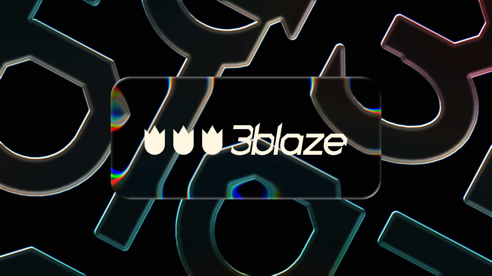
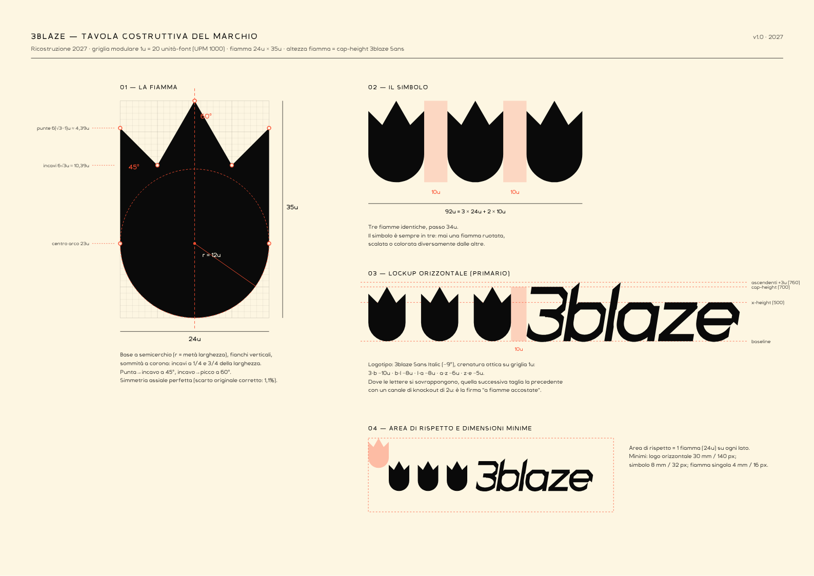
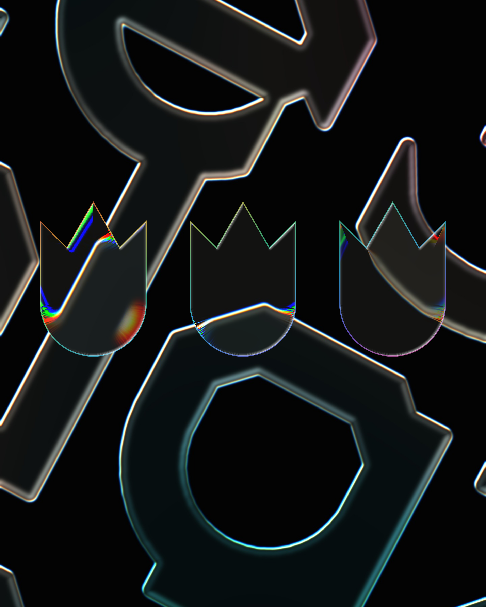
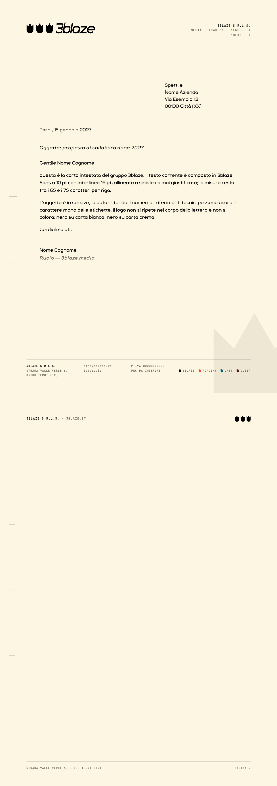
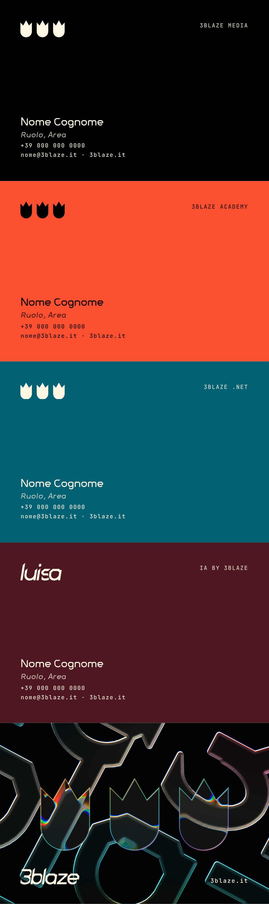
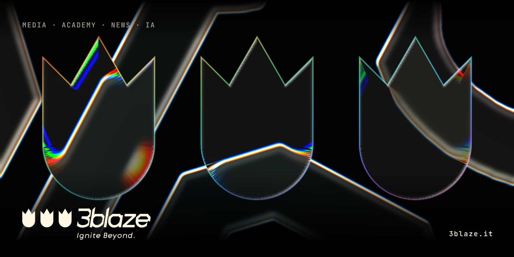
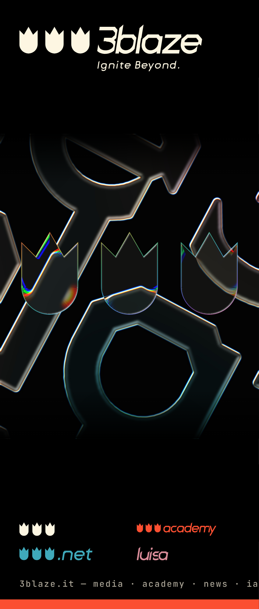
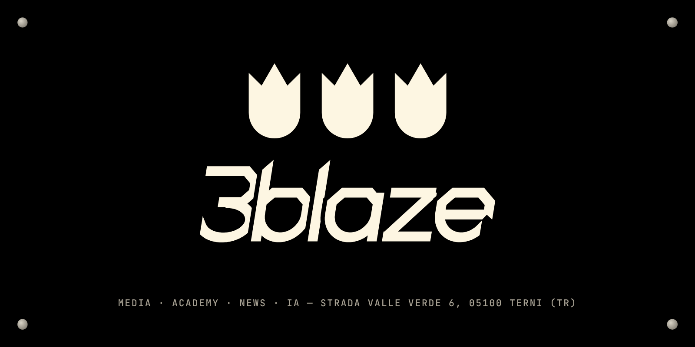
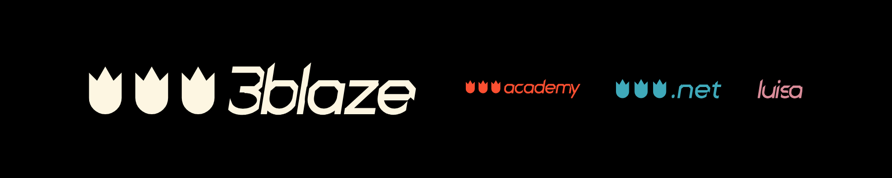
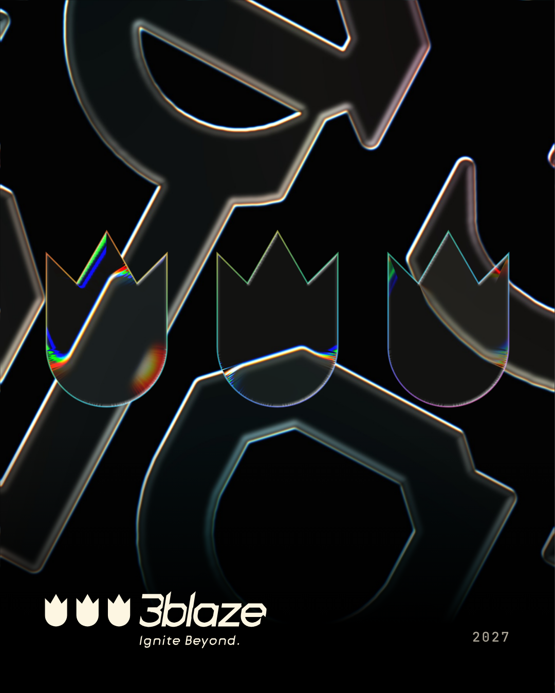

# 3blaze — Brand System 2027 · Documento completo per persone e IA

> Questo file contiene TUTTO il Design System 3blaze 2027 in un unico testo: regole, misure, colori, token, codice dei componenti, codice del Liquid Glass, geometria e SVG del marchio, elenco dei file. È la versione testuale dell'artifact "3blaze — Brand System 2027". Un'IA che legge solo questo file ha tutte le informazioni per produrre materiali conformi.
>
> Versione 1.0 · 17/11/2026 · Proprietario: 3BLAZE S.R.L.S. · Ordine di autorità: questo documento > manuale PDF > esempi.

## Indice
1. Panoramica (README)
2. Marchio · 3. Colore · 4. Tipografia · 5. Liquid Glass · 6. Layout e immagini (Trama Vetro) · 7. Stampati · 8. Cartellonistica e social · 9. Voce · 10. Per le IA
11. Componenti (regole d'uso)
- Appendice A — Token di design (CSS e JSON)
- Appendice B — Codice Liquid Glass (JS + CSS)
- Appendice C — Codice dei componenti (CSS, JS, tipi)
- Appendice D — Marchio: geometria e SVG ufficiali
- Appendice E — Elenco dei file della cartella brand-2027


---

## 3blaze — Brand System 2027

> **Spigoli in alto, curve in basso. Come il fuoco.**
> Il sistema d'identità della holding 3blaze e delle sue divisioni: media, academy, .net (news) e luisa (IA). Questo documento è scritto per essere letto allo stesso modo da persone e da intelligenze artificiali: ogni regola ha un valore, un token o un file a cui riferirsi.



### 1. Chi siamo, in una riga per divisione

| Divisione | Nome nel marchio | Colore (token) | Ruolo |
|---|---|---|---|
| Holding / media | **3blaze** | Nero `--brand-nero` #000000 | Strategia, contenuti, produzione video, brand management. È anche la voce del gruppo. |
| Formazione | **3blaze academy** | Brace `--academy` #FB4F31 | Corsi, workshop, percorsi per aziende e scuole. |
| News | **3blaze .net** | Petrolio `--news` #006172 | Informazione, rubriche, matchday e territorio. |
| Intelligenza artificiale | **luisa** | Vinaccia `--ia` #4D1821 | L'assistente IA proprietaria del gruppo. Unico marchio senza le tre fiamme: la fiamma è il punto della *i*. |

Il Crema `--brand-crema` #FDF6E2 è il "bianco" di tutto il gruppo: logo, testo su fondi scuri, carta. Il bianco puro #FFFFFF non è un colore del brand (si accetta solo come carta da ufficio).

### 2. Le cinque regole non negoziabili

1. **Il marchio non si ridisegna.** Si usano solo i file SVG di `assets/Logo/`. Niente testo "3blaze" scritto a mano con il font al posto del logotipo: il logotipo ha crenature e tagli di knockout che il font da solo non ha.
2. **Una divisione, un colore.** Ogni materiale ha un colore di divisione dominante (fondo o logo) e al massimo un accento: la Brace. Mai due colori di divisione come fondi nella stessa superficie, salvo i materiali di gruppo (holding) che li elencano tutti.
3. **Due caratteri, ruoli fissi.** *3blaze Sans* per tutto. *3blaze Display* solo per titoli grandi (≥ 48 px / ≥ 18 pt), in maiuscolo o in frasi di massimo 4 parole. Il mono (JetBrains Mono) è lo strato "codice": etichette, numerazioni, metadati.
4. **Il vetro è vero o non c'è.** Il liquid glass 3blaze è rifrazione reale con bordo arcobaleno (vedi *Liquid Glass*). Un `backdrop-filter: blur()` da solo non è il nostro vetro: è il fallback, e si dichiara come tale.
5. **Spigoli in alto, curve in basso.** È la forma della fiamma e diventa la regola di layout: tagli netti e allineamenti duri in alto, archi e raggi pieni in basso (bottoni a pillola, foto con base arrotondata, card con raggio pieno solo sotto).

### 3. Mappa del sistema

| Sezione | Cosa contiene |
|---|---|
| **Marchio** | Geometria ricostruita (griglia 1u), versioni, area di rispetto, dimensioni minime, usi scorretti, sub-brand. |
| **Colore** | Palette, abbinamenti per settore, contrasti verificati WCAG, proporzioni. |
| **Tipografia** | 3blaze Sans, 3blaze Display, mono; scala, regole, CSS pronto. |
| **Liquid Glass** | Il vetro rifrangente con bordo arcobaleno: principio, parametri, codice, quando usarlo. |
| **Layout e immagini** | Griglia, spaziature, motivo "spigoli/curve", fotografia, iconografia. |
| **Stampati** | Carta intestata, biglietti da visita, busta, firma email: misure e file. |
| **Cartellonistica e social** | Roll-up, affissione 6×3, targa, insegna, avatar, cover, post. |
| **Voce** | Tono, il claim Ignite Beyond, parole da evitare. |
| **Per le IA** | Specifica compatta in YAML, prompt-base per generare immagini e layout, checklist di verifica. |

### 4. Come si usa questo sistema

- **Designer**: scaricate SVG e PDF da *Assets*; i colori e i caratteri sono in *Tokens* e *Typography*.
- **Sviluppatori**: `tokens.css` (generato) espone tutte le variabili; `components/bundle.js` espone `window.Blaze.LiquidGlass`; `components/bundle.css` contiene le classi `.lg`, `.btn`, `.tag`, `.flame-frame`.
- **IA (LLM, agenti, generatori di immagini)**: leggete prima questa pagina, poi la sezione *Per le IA*. Usate i nomi dei token, mai valori inventati. Se una regola non copre il caso, scegliete la soluzione più sobria: fondo Nero o Crema, un solo accento Brace.

### 5. Origine e versioni

- Ricostruzione del marchio: novembre 2026, a partire dal lettering *3blaze Sans v0.2*, dal font *3blaze Display* e dalla tavola di rebranding con la palette per settore.
- Modifiche rispetto al marchio precedente: fiamma resa perfettamente simmetrica (scarto dell'originale 1,1%), angoli normalizzati a 45° e 60°, altezza della fiamma agganciata alla cap-height del Sans (700/1000), spaziature su griglia di 1u = 20 unità.
- Dati societari da completare prima della stampa: **P.IVA, PEC, telefono** (nei file compaiono come segnaposto).

---

## Marchio



### La fiamma: geometria esatta

Unità di griglia **1u = 20 unità-font** (il 3blaze Sans ha UPM 1000). La fiamma occupa **24u × 35u**: la sua altezza (700) coincide con la cap-height del 3blaze Sans, così simbolo e logotipo condividono la stessa linea di base e la stessa linea delle maiuscole.

| Elemento | Valore | Note |
|---|---|---|
| Larghezza | 24u (480) | |
| Altezza | 35u (700) | = cap-height 3blaze Sans |
| Picco centrale | (12u, 0) | asse di simmetria |
| Incavi | x = 6u e 18u, y = 6√3u ≈ 10,39u | incavo→picco a **60°** |
| Punte laterali | x = 0 e 24u, y = 6(√3−1)u ≈ 4,39u | punta→incavo a **45°** |
| Fianchi | verticali, da 4,39u a 23u | |
| Base | semicerchio r = 12u, centro (12u, 23u) | |

Path SVG di riferimento (viewBox `0 0 480 700`):

```
M0 87.85 L120 207.85 L240 0 L360 207.85 L480 87.85 L480 460 A240 240 0 0 1 0 460 Z
```

### Il simbolo

Tre fiamme identiche, **spazio tra le fiamme 10u (200)**, larghezza totale **92u (1840 × 700)**. Le tre fiamme stanno sempre insieme, alla stessa scala e nello stesso colore.

### Il logotipo

"3blaze" composto in **3blaze Sans Italic** (inclinazione −9°) con crenatura ottica su griglia di 1u:

| Coppia | 3·b | b·l | l·a | a·z | z·e |
|---|---|---|---|---|---|
| Crenatura | −10u | −8u | −8u | −6u | −5u |

Dove due lettere si toccano, la lettera successiva taglia la precedente con un **canale di knockout di 2u**: è la firma visiva del logotipo ("fiamme accostate"). Per questo il logotipo non va mai riscritto con il font: va usato il file.

### Versioni

| File | Uso |
|---|---|
| `3blaze_logo_horizontal_*` | **Primaria.** Simbolo + logotipo, spazio 10u, fondo fiamma = linea di base. |
| `3blaze_logo_stacked_*` | Spazi verticali o quadrati (targhe, avatar grandi, copertine). |
| `3blaze_symbol_*` | Avatar, favicon grandi, timbri, ricamo, pattern. |
| `3blaze_flame_*` | Favicon 16–32 px, punto elenco, separatore, segno di chiusura. |
| `3blaze_wordmark_*` | Dove il simbolo è già presente nella stessa vista. |
| `3blaze_academy_*`, `3blaze_net_*` | Sub-brand con simbolo. |
| `luisa_*` | Sub-brand IA: solo logotipo; la fiamma è il punto della *i*. |
| `3blaze_logo_claim_*` | Marchio con la firma *Ignite Beyond.* (vedi Voce). |
| `3blaze_claim_*` | Il claim da solo, per le chiusure di video e slide. |

Colori disponibili per ogni file: `_black` (#000000), `_cream` (#FDF6E2), più il colore della divisione per i sub-brand (`_orange`, `_teal`, `_wine`). I file senza suffisso usano `currentColor` e prendono il colore del testo.

### Area di rispetto e dimensioni minime

- **Area di rispetto**: una fiamma intera (24u, cioè la larghezza di una fiamma alla scala d'uso) su ogni lato.
- **Minimi**: logo orizzontale 30 mm / 140 px · logo verticale 18 mm / 90 px · simbolo 8 mm / 32 px · fiamma singola 4 mm / 16 px.

### Abbinamenti logo / fondo ammessi

| Fondo | Logo |
|---|---|
| Nero | Crema |
| Crema o carta bianca | Nero |
| Brace (academy) | Nero oppure Crema (solo ≥ 30 mm) |
| Petrolio (.net) | Crema |
| Vinaccia (luisa) | Crema |
| Foto | Crema su zona scura, Nero su zona chiara; altrimenti su pannello liquid glass |

### Usi scorretti

- Ridisegnare, ricomporre o riscrivere il logotipo con il font.
- Ruotare, deformare, aggiungere contorni, ombre, rilievi o gradienti al marchio.
- Cambiare il numero, l'ordine o la spaziatura delle fiamme; colorare le tre fiamme diversamente.
- Usare il colore di una divisione per il logo di un'altra.
- Mettere il logo su fondi con contrasto inferiore a 3:1.
- Applicare il liquid glass *al* logo: il vetro sta sotto il logo, mai dentro le sue forme.

---

## Colore

Il gruppo vive su due fondi, **Nero** e **Crema**. Ogni divisione aggiunge il proprio colore pieno. La Brace è anche l'accento di tutto il gruppo: è la fiamma.

### Palette istituzionale

| Nome | Token | HEX | RGB | CMYK (indicativo, da verificare con prova colore) | Divisione |
|---|---|---|---|---|---|
| Nero | `--brand-nero` | #000000 | 0 0 0 | 60 40 40 100 (nero ricco) | 3blaze / media / holding |
| Crema | `--brand-crema` | #FDF6E2 | 253 246 226 | 0 2 10 0 | tutto il gruppo |
| Brace | `--academy` | #FB4F31 | 251 79 49 | 0 80 85 0 | academy · accento di gruppo |
| Petrolio | `--news` | #006172 | 0 97 114 | 95 40 35 25 | .net (news) |
| Vinaccia | `--ia` | #4D1821 | 77 24 33 | 35 90 65 60 | luisa (IA) |

Le conversioni CMYK e Pantone vanno fissate con lo stampatore sulla carta scelta: i valori qui sopra sono punti di partenza, non specifiche finali.

### Abbinamenti per settore

| Divisione | Fondo | Testo / logo | Accento ammesso |
|---|---|---|---|
| 3blaze (media, holding) | Nero | Crema | Brace (un elemento) |
| 3blaze academy | Brace | Nero (testi piccoli) · Crema (≥ 24 px) | Nero |
| 3blaze .net | Petrolio | Crema | Brace per "live"/"ultim'ora" |
| luisa | Vinaccia | Crema | nessuno: il bordo arcobaleno del vetro fa da accento |

### Contrasti verificati (WCAG 2.2)

| Coppia | Rapporto | Uso consentito |
|---|---|---|
| Crema su Nero | 19,5:1 | tutto |
| Nero su Brace | 6,3:1 | tutto |
| Crema su Brace | 3,1:1 | solo testo ≥ 24 px e logo ≥ 30 mm |
| Crema su Petrolio | 6,6:1 | tutto |
| Crema su Vinaccia | 13,3:1 | tutto |
| Brace su Crema | 3,1:1 | solo titoli ≥ 24 px; per testo piccolo usare `--academy-ink` #C93A20 (4,7:1) |
| Petrolio su Nero | 2,9:1 | **mai per testo**: usare `--news-ink` #3FA9BA (7,6:1) |
| Vinaccia su Nero | 1,5:1 | **mai**: usare `--ia-ink` #D98C99 (8,2:1) |
| `--ink-muted` su ground | 5,3:1 (crema) · 8,3:1 (nero) | testo secondario |

### Proporzioni

Su una superficie tipica: **70% fondo** (Nero o Crema), **20% colore di divisione**, **≤ 10% Brace**. La Brace non fa mai da fondo di una pagina della holding: è un segnale, non un ambiente.

### Il Prisma (solo per il vetro)

`--prism-1…6` (#FF4F31 · #FFD23F · #3DDC97 · #2EC4FF · #7B61FF · #FF5FA2) esistono solo come dispersione del liquid glass e del suo bordo. Non sono colori del brand: mai fondi, mai testo, mai icone, mai gradienti decorativi.

### Temi digitali

`data-theme="dark"` (primario, fondo Nero) e `data-theme="light"` (fondo Crema). Tutti i token `*-ink`, `ground`, `surface-*`, `ink*` cambiano valore per tema; i colori di divisione restano fissi.

---

## Tipografia

### I caratteri

| Carattere | File | Ruolo |
|---|---|---|
| **3blaze Sans** (500, tondo e corsivo) | `fonts/3blazeSans-Regular.woff2`, `fonts/3blazeSans-Italic.woff2` | **Carattere principale.** Titoli fino a 48 px, testo, interfacce, documenti. Ogni lettera segue la fiamma: base a semicerchio, fianchi dritti, sommità smussate a 45°; il punto della *i* e della *j* è una fiamma. |
| **3blaze Display** (400) | `fonts/3blazeDisplay-Regular.woff2` | **Solo titoli grandi.** Pesante, inclinato (−12°), con retino a mezzatinta incorporato nel disegno. Mai sotto 48 px / 18 pt. |
| **JetBrains Mono** (400, 500) | `fonts/JetBrainsMono-*.woff2` (OFL) | Lo strato "codice": etichette in maiuscolo, numerazioni, metadati, snippet. Mai per frasi. |

> Nel CSS i nomi dei font vanno **sempre tra virgolette**: `font-family: '3blaze Sans'`. Un nome che inizia con una cifra senza virgolette è CSS non valido e il browser lo ignora in silenzio.

### Scala

| Stile | Carattere | Corpo / interlinea | Uso |
|---|---|---|---|
| `display-xl` | Display | 160 / 0,92 | manifesti, hero |
| `display-l` | Display | 112 / 0,95 | apertura di sezione |
| `display-m` | Display | 72 / 1,0 | numeri chiave, slide (minimo assoluto 48) |
| `headline-l` | Sans | 48 / 1,05, −0,02em | H1 |
| `headline-m` | Sans | 32 / 1,15, −0,01em | H2 |
| `title` · `title-italic` | Sans | 24 / 1,25 | H3, occhielli in corsivo |
| `body-l` | Sans | 19 / 1,55 | lead |
| `body` | Sans | 16 / 1,6 | testo corrente, misura 60–72 caratteri |
| `small` | Sans | 14 / 1,5 | note, form |
| `caption` | Sans corsivo | 13 / 1,45 | didascalie |
| `label` | Mono 500 | 12 / 1,3, +0,12em, MAIUSCOLO | etichette, numerazioni "01 —" |
| `code` | Mono 400 | 14 / 1,55 | codice, dati |

In stampa: testo corrente 9,5–10 pt, didascalie 7,5 pt, etichette mono 6–7 pt.

### Regole

- **Un solo peso.** Entrambi i caratteri del brand hanno un peso: la gerarchia si fa con corpo, corsivo, colore e spazio, mai con il grassetto sintetico (`font-weight: 700` è vietato).
- **Corsivo = voce.** Il corsivo del Sans porta occhielli, citazioni, oggetti di lettera, il nome di luisa.
- **Display in breve.** Massimo 4 parole o un numero; maiuscolo consigliato (numeri di sezione, cifre chiave, nomi di divisione). Il claim *Ignite Beyond.* non si compone mai in Display.
- **Effetto blur del Display.** Facoltativo, solo sul web e solo ≥ 48 px: `filter: blur(0.009em)` (più morbido 0.012em, più nitido 0.006em).
- **Allineamento** a sinistra, mai giustificato; niente sillabazione nei titoli.
- **Numeri** nel Sans; le cifre del Display solo per numeri-titolo.

### CSS minimo

```css
@font-face { font-family: '3blaze Sans'; src: url(fonts/3blazeSans-Regular.woff2) format('woff2'); font-weight: 500; font-display: swap; }
@font-face { font-family: '3blaze Sans'; src: url(fonts/3blazeSans-Italic.woff2) format('woff2'); font-weight: 500; font-style: italic; font-display: swap; }
@font-face { font-family: '3blaze Display'; src: url(fonts/3blazeDisplay-Regular.woff2) format('woff2'); font-display: swap; }
body { font-family: '3blaze Sans', Futura, system-ui, sans-serif; font-weight: 500; }
.display { font-family: '3blaze Display', '3blaze Sans', sans-serif; font-weight: 400; line-height: .95; }
```

---

## Liquid Glass



### Il principio

Il vetro 3blaze è **una lente, non una nebbia**. Un pannello di vetro spesso con il bordo convesso: al centro lo sfondo si vede quasi intatto, verso il bordo viene piegato e compresso, e sul filo del bordo la luce si scompone nei colori del prisma. È il "bordo arcobaleno", più intenso negli angoli dove la curvatura è massima.

| Vetro finto (vietato come stile) | Vetro 3blaze |
|---|---|
| `backdrop-filter: blur(24px)` + bordo bianco 1px | rifrazione reale con `feDisplacementMap` |
| sfoca e basta: lo sfondo "si spalma" | piega lo sfondo: le righe si curvano verso il bordo |
| bordo bianco uniforme | dispersione R/G/B: frange arcobaleno sugli angoli |
| funziona su qualunque fondo | ha senso solo sopra contenuto con contrasto (tipografia, foto) |

### Come funziona (spiegato per chi lo deve rifare)

1. Si genera una **mappa di spostamento** grande quanto il pannello: per ogni pixel si calcola la distanza dal bordo e la normale della forma (rettangolo arrotondato in forma analitica; forme libere, come la fiamma, con una trasformata di distanza esatta).
2. Nella fascia del bordo (`--glass-bezel`, 40 px di default) l'intensità segue un profilo di lente convessa: massima sul filo, che svanisce verso l'interno. La direzione punta verso l'interno: il bordo comprime lo sfondo.
3. Il filtro SVG applica la mappa **tre volte**, una per canale: rosso a `scale × (1 − 0,22)`, verde a `scale`, blu a `scale × (1 + 0,22)`. I tre canali spostati di quantità diverse si ricompongono e dove lo spostamento è forte nasce l'arcobaleno.
4. Sopra: una luce speculare radente (alto-sinistra) solo sul filo del bordo, un velo `--glass-tint`, l'ombra `--shadow-glass`, e per i pannelli rettangolari un filetto iridescente al 55% in `screen`.

### Parametri (token)

| Token | Default | Effetto |
|---|---|---|
| `--glass-bezel` | 40px | larghezza della fascia che rifrange |
| `--glass-refraction` | 70 | quanto viene spostato lo sfondo |
| `--glass-dispersion` | 0.22 | separazione dei canali → intensità dell'arcobaleno |
| `--glass-blur` | 1.2px | ammorbidisce solo i dettagli finissimi |
| `--radius-lg` / `--radius-xl` | 32 / 48px | raggio dei pannelli |

Hero e manifesti: bezel 56–70, refraction 80–110. Interfacce: bezel 28–40, refraction 50–70.

### Codice

```html
<link rel="stylesheet" href="components/bundle.css">
<script src="components/bundle.js"></script>

<!-- pannello rettangolare -->
<div data-lg data-lg-radius="32" data-lg-bezel="40" data-lg-scale="70">…contenuto…</div>

<!-- fiamma di vetro (forma libera); per le tre fiamme usare il path del simbolo 3blaze_symbol -->
<div style="width:240px;height:350px" data-lg data-lg-bezel="40" data-lg-scale="90"
     data-lg-viewbox="0 0 480 700"
     data-lg-path="M0 87.85 L120 207.85 L240 0 L360 207.85 L480 87.85 L480 460 A240 240 0 0 1 0 460 Z"></div>

<script> Blaze.LiquidGlass.attach(el, { radius: 32, bezel: 40, scale: 70, dispersion: .22 }); </script>
```

### Compatibilità

- **Chromium** (Chrome, Edge, Arc, Opera, Brave): rifrazione completa via `backdrop-filter: url(#filtro)`.
- **Safari e Firefox**: la libreria passa da sola al fallback `.lg--fallback` (vetro sfocato + filetto iridescente). È accettabile, ma non è il riferimento del brand.
- **Stampa, video, social**: il vetro si usa come immagine renderizzata (le scene *Prisma* in *Assets / Liquid Glass*), mai ricreato con effetti "glass" dei programmi di impaginazione.
- `prefers-reduced-transparency`: il pannello diventa opaco `--surface-2`.

### Quando usarlo

- **Sì**: sopra tipografia Display in movimento, foto, video; per un solo elemento protagonista per vista (hero, player, card di prezzo, avatar).
- **No**: su fondo piatto (non c'è niente da rifrangere), per tutti i componenti di una pagina, sotto testo lungo, sopra il logo o dentro le sue forme.
- **Testo sul vetro**: sempre Crema su vetro sopra fondo scuro, con ombra di sicurezza `0 1px 2px #0008`; verificare il contrasto sul punto peggiore dello sfondo.

---

## Layout e immagini

### Il motivo: spigoli in alto, curve in basso

La fiamma è un'unica idea formale e il layout la ripete:

- **In alto, spigoli**: tagli netti, testate allineate a filo, etichette mono, filetti orizzontali (`--hairline`) che dividono le righe tipografiche come nella scena *Prisma*.
- **In basso, curve**: bottoni a pillola (`--radius-pill`), immagini e card con raggio pieno solo sugli angoli inferiori (classe `.flame-frame`), chiusure di pagina morbide.

```css
.flame-frame { border-radius: 0 0 var(--radius-xl) var(--radius-xl); overflow: hidden; }
```

### Griglia

| Formato | Colonne | Margine | Gutter |
|---|---|---|---|
| Desktop ≥ 1200 px | 12 | `--space-24` (96) | `--space-8` (32) |
| Tablet | 8 | `--space-16` (64) | `--space-6` (24) |
| Mobile | 4 | `--space-6` (24) | `--space-4` (16) |
| A4 stampa | 12 su 170 mm | 20 mm laterali, 17 mm testa | 4 mm |

Le spaziature seguono la scala da 4 px (`--space-1` … `--space-32`). Tra blocchi: `--space-12`; tra sezioni: `--space-24`.

### La scena Prisma

Lo sfondo-firma del gruppo è la **Trama Vetro**: la parola **3blaze** fatta di vetro scuro, fuori scala, ruotata di 28° e ripetuta in righe che si incastrano, su Nero. Come negli sfondi Apple (MacBook Neo, MacBook Pro) la scritta non si dichiara: si scopre. Le lettere sono così grandi che restano solo frammenti.

I colori del brand vivono **solo sul filo dei bordi**, come dispersione del vetro: Brace, rosa vinaccia, Crema e Petrolio sfumano lentamente da una zona all'altra; il corpo del vetro resta quasi nero. Si usa solo su Nero, mai sul tema Crema. File: `assets/Trama/3blaze_trama_vetro_16x9.jpg` e `_9x16.jpg` (in CSS: classe `.prisma`, `.prisma--vertical`, posizione con `--prisma-pos`).

Sopra la trama vive un solo oggetto di vetro: **le tre fiamme di vetro** (il simbolo, con rifrazione e bordo arcobaleno), un pannello con il marchio o i controlli di un'interfaccia. La trama non sostituisce mai il marchio: dove compare la scena, il marchio pieno è comunque presente una volta.

### Fotografia

- Luce vera, contrasto alto, neri profondi: le foto devono reggere il fondo Nero.
- Persone al lavoro, mani, set, backstage, campi da gioco, aule: mai foto di stock in posa.
- Tagli decisi, soggetto decentrato; base arrotondata con `.flame-frame` quando la foto è un riquadro.
- Nessun filtro colorato di divisione sopra le foto: il colore di divisione sta intorno, non sopra.

### Iconografia

- Tratto 1,5 px su griglia 24, terminali squadrati, angoli superiori vivi e inferiori arrotondati (come la fiamma).
- Monocromatiche in `--ink`; mai icone colorate o emoji nei materiali istituzionali.
- La fiamma singola (`3blaze_flame`) sostituisce il punto elenco nelle liste di brand e chiude gli articoli di .net.

### Movimento

Durate `160ms` (hover), `280ms` (pannelli), `600ms` (hero); easing `cubic-bezier(.2,.8,.2,1)`. Il vetro si muove lento sopra righe che scorrono in orizzontale a velocità diverse; nessun rimbalzo, nessuna rotazione del marchio.

---

## Stampati

Tutti i file sono PDF vettoriali con i font incorporati (in *Assets / Stampati*). Prima di andare in stampa: inserire **P.IVA, PEC e telefono** (oggi segnaposto), convertire i colori con lo stampatore, chiedere una prova colore della Brace.

### Carta intestata A4



| Elemento | Specifica |
|---|---|
| Formato | 210 × 297 mm, due versioni: **bianco** (stampa da ufficio) e **crema** (PDF digitale o carta tinta crema) |
| Logo | orizzontale nero, 52 mm, a 20 mm dal margine sinistro e 17 mm dall'alto |
| Dati in testa | mono 6,6 pt maiuscolo, allineati a destra: ragione sociale, divisioni, sito |
| Corpo | 3blaze Sans 10/16 pt, margini 30 mm, destinatario a 125 mm dal bordo sinistro (finestra busta) |
| Oggetto | corsivo |
| Piede | mono 5,9 pt su quattro colonne: sede · contatti · P.IVA/PEC · le quattro divisioni con la fiamma nel loro colore |
| Segni | piega a 99 e 198 mm, foratura a 148,5 mm |
| Seconda pagina | simbolo 12 mm in alto a destra, ragione sociale in alto a sinistra, piede ridotto |
| Firma visiva | una fiamma al 5% tagliata nell'angolo in basso a destra |

### Biglietto da visita



| Elemento | Specifica |
|---|---|
| Formato | 85 × 55 mm, abbondanza 3 mm per lato (file a 91 × 61 mm), area sicura 4 mm |
| Fronte | fondo nel colore della divisione: Nero (media), Brace (academy, inchiostro nero), Petrolio (.net), Vinaccia (luisa) |
| Contenuto fronte | simbolo 15 mm in alto a sinistra (luisa: logotipo); divisione in mono in alto a destra; nome Sans 10 pt, ruolo corsivo 7 pt, contatti mono 5,4 pt |
| Retro | comune a tutte le divisioni: scena Prisma con le tre fiamme di vetro, logotipo crema 20 mm, `3blaze.it` |
| Carta consigliata | 400–600 g/m² uncoated, retro in stampa digitale HD o offset; per la holding valutare il fronte a caldo crema su cartoncino nero colorato in pasta |

### Busta DL

220 × 110 mm, bianca. Logo orizzontale 42 mm a 12/11 mm dal bordo; mittente in mono 6 pt; quattro fiamme delle divisioni in basso a sinistra; finestra 90 × 45 mm a 110/50 mm (allineata al destinatario della carta intestata).

### Firma email

File `firma_email.html` (nella cartella del progetto). Logo PNG @2x largo 132 px ospitato su `3blaze.it/brand/`, nome Sans 14 px, ruolo corsivo, contatti in mono 11 px, link al sito in `--academy-ink`, riga delle divisioni con quadratini colorati. Niente immagini di sfondo, niente banner.

### Altri materiali da derivare con le stesse regole

Cartellina A4 (Nero, simbolo e marchio con claim in Crema, scena Prisma all'interno) · badge eventi (fondo divisione, ruolo in Display) · timbro (simbolo + ragione sociale in mono).

---

## Cartellonistica e social

I file di grande formato sono impaginati **in scala** (indicata nel nome) e sono vettoriali tranne la scena di vetro, che è un'immagine renderizzata: a scala reale corrisponde a circa 30 dpi sull'affissione e 75 dpi sul roll-up, sufficienti alla distanza di lettura. Per una risoluzione superiore si rigenera la scena con `build_scene.py` alla dimensione richiesta.

### Affissione 6 × 3 m (scala 1:10)



Nessun titolo: le tre fiamme di vetro sulla scena Prisma occupano il formato, il marchio con il claim *Ignite Beyond.* firma in basso a sinistra, `3blaze.it` in mono in basso a destra. Per una campagna di divisione si aggiunge un solo messaggio breve in 3blaze Sans.

### Roll-up 85 × 200 cm (scala 1:4)



Dall'alto: marchio con claim (sempre sopra i 160 cm, visibile oltre la folla) → scena Prisma con le tre fiamme di vetro → i quattro marchi di divisione → sito → fascia Brace di 8 cm a terra (zona che finisce nella base del roll-up, nessun contenuto).

### Targa d'ingresso 40 × 20 cm



Plexiglass nero lucido 8 mm, logo verticale stampato UV crema (o inciso e laccato), riga mono con le divisioni e l'indirizzo, quattro distanziali in acciaio satinato.

### Insegna a cassonetto 300 × 60 cm (scala 1:10)



Fondo nero opaco, logo orizzontale crema retroilluminato (lettere scatolate o pellicola su plexi opalino), marchi di divisione nei loro colori chiari a destra. Di notte il Crema deve restare caldo: LED 3000 K.

### Social

| Formato | Misure | Regola |
|---|---|---|
| Avatar | 1080 × 1080 | simbolo crema su Nero, centrato, area di rispetto per il ritaglio circolare. Divisioni: fondo nel proprio colore. |
| Cover LinkedIn | 1584 × 396 | scena Prisma, pannello di vetro con il logo nel terzo destro (a sinistra c'è la foto profilo). |
| Post 4:5 | 1080 × 1350 | scena con le tre fiamme di vetro, marchio con claim in basso, etichetta mono. |
| Story / Reel | 1080 × 1920 | aree sicure: 250 px in alto, 340 px in basso; headline sopra la metà. |



---

## Voce

### Come parla 3blaze

- **Diretta.** Frasi brevi, verbi attivi, la cosa più importante per prima.
- **Concreta.** Numeri, tempi, nomi: "consegna in 3 settimane", non "tempi rapidi".
- **Calda, non urlata.** Il fuoco scalda prima di bruciare: niente maiuscole gridate nel testo corrente, niente punti esclamativi a raffica.
- **Tecnica quando serve.** Lo strato mono esiste per i dati: non si nasconde la complessità, la si ordina.
- **Italiano prima.** L'inglese solo per nomi di prodotto e termini senza equivalente (es. "reel", "matchday").

### Il claim: Ignite Beyond.

> *Ignite Beyond.* — accendi l'oltre.

Dice cosa fa il gruppo per chi lavora con lui: accendere un'idea e portarla più in là di dove sarebbe arrivata da sola. **Non è il protagonista**: come *Think different.* per Apple, è una firma che si legge per ultima e resta.

- **Dove**: sotto il marchio (file `3blaze_logo_claim`), in chiusura di video e presentazioni (`3blaze_claim`), in fondo a un'affissione o a un sito. Una sola volta per materiale.
- **Come**: 3blaze Sans Italic, maiuscole iniziali, punto finale, nello stesso colore del marchio. Altezza delle maiuscole pari al 28% della fiamma del marchio che accompagna.
- **Mai**: come titolo, in 3blaze Display, tutto maiuscolo, con il punto esclamativo, in un colore diverso dal marchio, tradotto nei materiali. *Accendi l'oltre* serve solo a spiegarlo.

### Frasi di divisione (proposte, subordinate al claim)

| Divisione | Claim | Uso |
|---|---|---|
| 3blaze media | Contenuti che restano accesi. | presentazioni, sito |
| 3blaze academy | Si impara facendo fuoco. | corsi, aule, badge |
| 3blaze .net | Notizie dal campo. | testata, social |
| luisa | L'intelligenza di casa. | prodotto, onboarding |

### Parole da evitare

"leader del settore", "a 360 gradi", "qualità garantita", "soluzioni innovative", "eccellenza", "make communication great again" e "Brucia l'ovvio" (claim precedenti, ritirati).

### Scrittura dei nomi

- **3blaze** sempre minuscolo, anche a inizio frase. Mai "3Blaze", "3 Blaze", "Treblaze".
- **3blaze academy**, **3blaze .net** (con lo spazio prima del punto), **luisa** (minuscolo).
- Nei testi legali: **3BLAZE S.R.L.S.**

---

## Per le IA

Questa sezione riassume il sistema in forma compatta per modelli linguistici, agenti di sviluppo e generatori di immagini. In caso di conflitto valgono le sezioni precedenti; i valori esatti stanno in `tokens.json`.

### Specifica compatta

```yaml
brand: 3blaze
type: holding (media, formazione, news, intelligenza artificiale)
location: Terni, Italia
version: 2027.1
divisions:
  - {id: media,   name: "3blaze",          color: "#000000", logo: 3blaze_logo_horizontal}
  - {id: academy, name: "3blaze academy",  color: "#FB4F31", logo: 3blaze_academy, ink_on_color: "#000000"}
  - {id: news,    name: "3blaze .net",     color: "#006172", logo: 3blaze_net,     ink_on_color: "#FDF6E2"}
  - {id: ia,      name: "luisa",           color: "#4D1821", logo: luisa,          ink_on_color: "#FDF6E2"}
neutrals: {nero: "#000000", crema: "#FDF6E2"}   # crema sostituisce il bianco
accent: "#FB4F31"                                # brace, max 10% della superficie
text_on_dark: {news: "#3FA9BA", ia: "#D98C99", muted: "#A8A294"}
text_on_light: {academy: "#C93A20", muted: "#6B665C"}
fonts:
  primary: {family: "3blaze Sans", weight: 500, styles: [normal, italic], use: "tutto"}
  display: {family: "3blaze Display", weight: 400, min_size_px: 48, use: "solo titoli grandi, max 4 parole"}
  mono:    {family: "JetBrains Mono", weight: [400, 500], use: "etichette maiuscole +0.12em, dati"}
logo:
  geometry: {unit: "1u = 20/1000 em", flame: "24u x 35u", flame_height: "= cap-height Sans (700)", gap: "10u", angles: [45, 60], base: "semicerchio r=12u"}
  never: [ridisegnare, riscrivere col font, ruotare, ombre, contorni, gradienti, colori di altre divisioni, vetro dentro il logo]
  clear_space: "1 larghezza di fiamma"
  min_size: {horizontal: "30mm/140px", symbol: "8mm/32px", flame: "4mm/16px"}
motif: "spigoli in alto, curve in basso"   # bottoni a pillola, foto e card con raggio solo in basso
glass:
  kind: "rifrazione reale + dispersione cromatica (bordo arcobaleno)"
  not: "backdrop-filter blur"
  params: {bezel_px: 40, refraction: 70, dispersion: 0.22, blur_px: 1.2, radius_px: 32}
  one_per_view: true
  over: [tipografia Display, foto, video]
signature_scene: "Prisma · Trama Vetro: la parola 3blaze in vetro scuro gigante, ruotata 28°, ripetuta in righe incastrate su Nero; colori del brand (Brace, rosa vinaccia, Crema, Petrolio) solo come dispersione sui bordi; sopra un solo oggetto di vetro: le tre fiamme (simbolo) o un pannello. File: assets/Trama/"
claim: {text: "Ignite Beyond.", meaning: "accendi l'oltre", role: "firma, mai titolo", font: "3blaze Sans Italic", files: [3blaze_logo_claim, 3blaze_claim], never: [Display, maiuscolo, esclamativo, traduzione nei materiali, colore diverso dal marchio]}
voice: {tone: [diretta, concreta, calda, tecnica quando serve], ban: ["leader del settore", "a 360 gradi", "qualità garantita"]}
naming: {brand: "3blaze (sempre minuscolo)", legal: "3BLAZE S.R.L.S."}
```

### Prompt-base per generare immagini nello stile 3blaze

> Fondo nero profondo. Grandi forme di vetro scuro e spesso, astratte e ruotate in diagonale, che si incastrano e escono dal quadro, illuminate solo da un filo di luce sui bordi con dispersione cromatica nei toni rosso-arancio brace, rosa antico, crema e petrolio; il corpo del vetro quasi nero. In primo piano tre oggetti di vetro trasparente a forma di fiamma a corona con base semicircolare, affiancati e identici, che rifrangono le forme dietro di sé, con frange arcobaleno sui bordi e riflesso speculare sottile in alto a sinistra. Fotografia di prodotto, nitida, minimale, nessun testo leggibile.

Il logo non va mai generato da un'IA: si sovrappone dopo, usando i file SVG.

### Checklist di verifica (da eseguire prima di consegnare)

1. Il logo è uno dei file SVG ufficiali, non ritoccato, con area di rispetto e sopra la dimensione minima?
2. C'è un solo colore di divisione dominante e la Brace occupa al massimo il 10%?
3. Ogni testo ha contrasto ≥ 4,5:1 (≥ 3:1 se ≥ 24 px)? Petrolio e Vinaccia non sono usati come testo su Nero?
4. Display solo ≥ 48 px e ≤ 4 parole? Nessun grassetto sintetico? Nomi dei font tra virgolette nel CSS?
5. Se c'è vetro: è rifrazione vera (o un render della scena), uno solo per vista, sopra contenuto e non su fondo piatto?
6. Il copy evita le parole bandite e scrive "3blaze" minuscolo? Il claim *Ignite Beyond.* compare al massimo una volta, come firma?
7. I dati societari segnaposto (P.IVA, PEC, telefono) sono stati sostituiti?

---

## Componenti

### Logo

I marchi del gruppo si usano solo dai file SVG in *Assets / Logo*; questa scheda mostra gli abbinamenti fondo/logo ammessi.

**Fornire.** Il file nel colore giusto (`_cream` su fondi scuri e colorati, `_black` su Crema, bianco e Brace) oppure la versione senza suffisso che eredita `currentColor`. Larghezza minima del logo orizzontale 140 px, area di rispetto pari a una fiamma.

**Mai.** Riscrivere "3blaze" con il font, cambiare colori o spaziature, ombre, contorni, vetro dentro le forme.

### Button

Bottone a pillola (`--radius-pill`): la curva in basso della fiamma applicata all'azione.

**Varianti.** `.btn--primary` (Brace con testo Nero, 6,3:1) per l'unica azione principale della vista · `.btn--secondary` (contorno `--ink`) · `.btn--glass` (solo sopra la scena Prisma o foto, con `data-lg`) · `.btn--sm` (36 px).

**Regole.** Un solo primario per vista. Testo in Sans 16 px, verbo all'infinito o all'imperativo ("Prenota una call", non "Clicca qui"). Icona facoltativa: solo la fiamma, a sinistra. Focus: anello `--focus` 2 px con 2 px di distanza.

### Tag

Etichetta di divisione o di stato a forma di fiamma rovesciata: angoli vivi in alto, raggio 12 px in basso.

**Varianti.** `.tag--media`, `.tag--academy`, `.tag--news`, `.tag--ia`; `.tag--live` aggiunge il punto pulsante per dirette e ultim'ora. Testo mono 11 px maiuscolo +0,12em. Per numerazioni e metadati senza fondo usare `.label`.

**Regole.** Il tag sta appoggiato al bordo superiore del contenuto che etichetta (come una linguetta), mai fluttuante in mezzo a un testo.

### LiquidGlass

Trasforma un elemento in una lente di vetro spesso che rifrange lo sfondo e scompone la luce sul bordo (bordo arcobaleno).

**Uso.** `data-lg` sull'elemento (attributi `data-lg-radius`, `data-lg-bezel`, `data-lg-scale`, `data-lg-dispersion`, `data-lg-path`, `data-lg-viewbox`) oppure `Blaze.LiquidGlass.attach(el, opzioni)`. Per la fiamma di vetro: `path: Blaze.FLAME_PATH, viewBox: Blaze.FLAME_VIEWBOX`.

**Cosa fornisce chi lo usa.** Uno sfondo con contenuto (tipografia, foto, video) dietro il pannello: su un fondo piatto il vetro non ha niente da piegare. Il contenuto *sopra* il vetro (testo, logo) è normale HTML figlio del pannello.

**Regole.** Un solo oggetto di vetro per vista. Testo sul vetro: Crema con ombra `0 1px 2px #0008`. Mai vetro dentro il logo. Su Safari/Firefox la classe `.lg--fallback` viene aggiunta da sola: è accettabile in interfaccia, non nei materiali di comunicazione (lì si usa il render della scena).

### PrismaScene

Lo sfondo-firma del gruppo: la **Trama Vetro**. La parola 3blaze è fatta di vetro scuro, fuori scala, ruotata di 28° e ripetuta in righe che si incastrano su Nero. Come negli sfondi Apple la scritta non si dichiara: si scopre. I colori del brand (Brace, rosa vinaccia, Crema, Petrolio) compaiono solo come dispersione sul filo dei bordi.

**Struttura.** `.prisma` mette la trama come sfondo (`assets/Trama/3blaze_trama_vetro_16x9.jpg`, `cover`). `.prisma--vertical` usa la versione 9:16. Il taglio si sposta con `--prisma-pos` (es. `70% 25%`). Dentro va un solo elemento `data-lg`: le tre fiamme di vetro (`data-lg-path` = path di `3blaze_symbol`) oppure un pannello con il marchio. Il vetro rifrange la trama.

**Regole.** Solo su Nero, mai sul tema Crema. Non si ricolora e non si rigenera a mano: si usano i file ufficiali. Dove compare la scena, il marchio pieno compare una volta; il claim *Ignite Beyond.* al massimo una volta, come firma.

---

## Appendice A — Token di design

I token sono la fonte di verità per colori, tipografia, spazi, raggi, ombre, movimento e vetro. In CSS si usano come variabili `--nome`.

### tokens.css
```css
/* 3blaze 2027 — tokens.css (generato da tokens_src.py). Non modificare a mano. */
:root, [data-theme="dark"] {
  --ground: #000000;
  --surface-1: #0E0E0E;
  --surface-2: #1A1A1A;
  --ink: #FDF6E2;
  --ink-muted: #A8A294;
  --hairline: #FDF6E224;
  --brand-nero: #000000;
  --brand-crema: #FDF6E2;
  --academy: #FB4F31;
  --academy-ink: #FB4F31;
  --news: #006172;
  --news-ink: #3FA9BA;
  --ia: #4D1821;
  --ia-ink: #D98C99;
  --accent: var(--academy);
  --focus: #2EC4FF;
  --prism-1: #FF4F31;
  --prism-2: #FFD23F;
  --prism-3: #3DDC97;
  --prism-4: #2EC4FF;
  --prism-5: #7B61FF;
  --prism-6: #FF5FA2;
  --glass-tint: #FDF6E20A;
  --shadow-glass: 0 24px 60px -18px #0000008C, 0 2px 6px #00000040;
  --shadow-lift: 0 8px 24px -8px #00000099;
}
[data-theme="light"] {
  --ground: #FDF6E2;
  --surface-1: #F6EDD3;
  --surface-2: #EDE3C6;
  --ink: #000000;
  --ink-muted: #6B665C;
  --hairline: #0000001F;
  --brand-nero: #000000;
  --brand-crema: #FDF6E2;
  --academy: #FB4F31;
  --academy-ink: #C93A20;
  --news: #006172;
  --news-ink: #006172;
  --ia: #4D1821;
  --ia-ink: #4D1821;
  --accent: var(--academy-ink);
  --focus: #2EC4FF;
  --prism-1: #FF4F31;
  --prism-2: #FFD23F;
  --prism-3: #3DDC97;
  --prism-4: #2EC4FF;
  --prism-5: #7B61FF;
  --prism-6: #FF5FA2;
  --glass-tint: #FFFFFF33;
  --shadow-glass: 0 24px 60px -24px #3D2A0A40, 0 2px 6px #3D2A0A1F;
  --shadow-lift: 0 8px 24px -10px #3D2A0A33;
}
:root {
  --space-1: 4px;
  --space-2: 8px;
  --space-3: 12px;
  --space-4: 16px;
  --space-6: 24px;
  --space-8: 32px;
  --space-12: 48px;
  --space-16: 64px;
  --space-24: 96px;
  --space-32: 128px;
  --radius-xs: 6px;
  --radius-sm: 12px;
  --radius-md: 20px;
  --radius-lg: 32px;
  --radius-xl: 48px;
  --radius-pill: 999px;
  --glass-bezel: 40px;
  --glass-refraction: 70;
  --glass-dispersion: 0.22;
  --glass-blur: 1.2px;
  --font-sans: "3blaze Sans", "Futura", system-ui, sans-serif;
  --font-display: "3blaze Display", "3blaze Sans", sans-serif;
  --font-mono: "JetBrains Mono", ui-monospace, "SF Mono", Menlo, monospace;
  --ease-out: cubic-bezier(.2,.8,.2,1);
  --dur-1: 160ms; --dur-2: 280ms; --dur-3: 600ms;
}
@font-face { font-family: '3blaze Sans'; src: url('../fonts/3blazeSans-Regular.woff2') format('woff2'); font-weight: 500; font-style: normal; font-display: swap; }
@font-face { font-family: '3blaze Sans'; src: url('../fonts/3blazeSans-Italic.woff2') format('woff2'); font-weight: 500; font-style: italic; font-display: swap; }
@font-face { font-family: '3blaze Display'; src: url('../fonts/3blazeDisplay-Regular.woff2') format('woff2'); font-weight: 400; font-style: normal; font-display: swap; }
@font-face { font-family: 'JetBrains Mono'; src: url('../fonts/JetBrainsMono-Regular.woff2') format('woff2'); font-weight: 400; font-style: normal; font-display: swap; }
@font-face { font-family: 'JetBrains Mono'; src: url('../fonts/JetBrainsMono-Medium.woff2') format('woff2'); font-weight: 500; font-style: normal; font-display: swap; }
.t-display-xl { font-family: var(--font-display); font-size: 160px; line-height: 0.92; font-weight: 400; letter-spacing: -0.01em; }
.t-display-l { font-family: var(--font-display); font-size: 112px; line-height: 0.95; font-weight: 400; letter-spacing: -0.01em; }
.t-display-m { font-family: var(--font-display); font-size: 72px; line-height: 1.0; font-weight: 400; }
.t-headline-l { font-family: var(--font-sans); font-size: 48px; line-height: 1.05; font-weight: 500; letter-spacing: -0.02em; }
.t-headline-m { font-family: var(--font-sans); font-size: 32px; line-height: 1.15; font-weight: 500; letter-spacing: -0.01em; }
.t-title { font-family: var(--font-sans); font-size: 24px; line-height: 1.25; font-weight: 500; }
.t-title-italic { font-family: var(--font-sans); font-size: 24px; line-height: 1.25; font-weight: 500; font-style: italic; }
.t-body-l { font-family: var(--font-sans); font-size: 19px; line-height: 1.55; font-weight: 500; }
.t-body { font-family: var(--font-sans); font-size: 16px; line-height: 1.6; font-weight: 500; }
.t-small { font-family: var(--font-sans); font-size: 14px; line-height: 1.5; font-weight: 500; }
.t-caption { font-family: var(--font-sans); font-size: 13px; line-height: 1.45; font-weight: 500; font-style: italic; }
.t-label { font-family: var(--font-mono); font-size: 12px; line-height: 1.3; font-weight: 500; letter-spacing: 0.12em; text-transform: uppercase; }
.t-code { font-family: var(--font-mono); font-size: 14px; line-height: 1.55; font-weight: 400; }
```

### tokens.json
```json
{
 "name": "3blaze",
 "version": 1,
 "meta": {
  "source": "Ricostruzione marchio 2027 (palette fornita da 3blaze, font 3blaze Sans v0.2 e 3blaze Display)",
  "motion": "Durate: 160ms (hover), 280ms (pannelli), 600ms (hero). Easing: cubic-bezier(.2,.8,.2,1)."
 },
 "color": {
  "themes": [
   {
    "id": "dark",
    "name": "Nero (primario)"
   },
   {
    "id": "light",
    "name": "Crema"
   }
  ],
  "tokens": [
   {
    "name": "ground",
    "value": {
     "dark": "#000000",
     "light": "#FDF6E2"
    },
    "usage": "Fondo pagina. Nero è il fondo del gruppo; Crema è il fondo editoriale e della carta."
   },
   {
    "name": "surface-1",
    "value": {
     "dark": "#0E0E0E",
     "light": "#F6EDD3"
    },
    "usage": "Prima superficie su ground: sezioni, pannelli opachi."
   },
   {
    "name": "surface-2",
    "value": {
     "dark": "#1A1A1A",
     "light": "#EDE3C6"
    },
    "usage": "Seconda superficie: card opache, campi di input."
   },
   {
    "name": "ink",
    "value": {
     "dark": "#FDF6E2",
     "light": "#000000"
    },
    "usage": "Testo e logo su ground/surface. 19,5:1."
   },
   {
    "name": "ink-muted",
    "value": {
     "dark": "#A8A294",
     "light": "#6B665C"
    },
    "usage": "Testo secondario, didascalie. ≥5,3:1 su ground in entrambi i temi."
   },
   {
    "name": "hairline",
    "value": {
     "dark": "#FDF6E224",
     "light": "#0000001F"
    },
    "usage": "Filetti 1px tra righe tipografiche e sezioni."
   },
   {
    "name": "brand-nero",
    "value": "#000000",
    "usage": "Colore istituzionale del gruppo 3blaze (media / holding)."
   },
   {
    "name": "brand-crema",
    "value": "#FDF6E2",
    "usage": "Crema 3blaze: il 'bianco' del brand. Mai #FFFFFF per fondi o logo."
   },
   {
    "name": "academy",
    "value": "#FB4F31",
    "usage": "Brace — 3blaze academy. Fondi, logo, numeri grandi. Testo crema su Brace solo ≥24px (3,1:1); per testo piccolo usare nero (6,3:1)."
   },
   {
    "name": "academy-ink",
    "value": {
     "dark": "#FB4F31",
     "light": "#C93A20"
    },
    "usage": "Brace come TESTO: su crema serve la versione profonda (4,7:1); su nero va bene la Brace piena (6,3:1)."
   },
   {
    "name": "news",
    "value": "#006172",
    "usage": "Petrolio — 3blaze .net (news). Fondi e logo. Crema su Petrolio 6,6:1."
   },
   {
    "name": "news-ink",
    "value": {
     "dark": "#3FA9BA",
     "light": "#006172"
    },
    "usage": "Petrolio come TESTO: su nero serve la versione chiara (7,6:1)."
   },
   {
    "name": "ia",
    "value": "#4D1821",
    "usage": "Vinaccia — luisa (IA). Fondi e logo. Crema su Vinaccia 13,3:1."
   },
   {
    "name": "ia-ink",
    "value": {
     "dark": "#D98C99",
     "light": "#4D1821"
    },
    "usage": "Vinaccia come TESTO: su nero serve la versione chiara (8,2:1)."
   },
   {
    "name": "accent",
    "value": {
     "dark": "{academy}",
     "light": "{academy-ink}"
    },
    "usage": "Accento del gruppo: la Brace. Una sola cosa per schermata (CTA, numero chiave)."
   },
   {
    "name": "focus",
    "value": "#2EC4FF",
    "usage": "Anello di focus da tastiera (2px + 2px di offset). Mai decorativo."
   },
   {
    "name": "prism-1",
    "value": "#FF4F31",
    "usage": "Prisma — solo bordo arcobaleno del liquid glass. Rosso."
   },
   {
    "name": "prism-2",
    "value": "#FFD23F",
    "usage": "Prisma — giallo."
   },
   {
    "name": "prism-3",
    "value": "#3DDC97",
    "usage": "Prisma — verde."
   },
   {
    "name": "prism-4",
    "value": "#2EC4FF",
    "usage": "Prisma — ciano."
   },
   {
    "name": "prism-5",
    "value": "#7B61FF",
    "usage": "Prisma — viola."
   },
   {
    "name": "prism-6",
    "value": "#FF5FA2",
    "usage": "Prisma — magenta. I sei Prisma esistono solo come rifrazione: mai fondi, mai testo."
   },
   {
    "name": "glass-tint",
    "value": {
     "dark": "#FDF6E20A",
     "light": "#FFFFFF33"
    },
    "usage": "Velo del pannello liquid glass sopra la rifrazione."
   }
  ]
 },
 "type": {
  "fonts": [
   {
    "family": "3blaze Sans",
    "file": "fonts/3blazeSans-Regular.woff2",
    "weight": "500",
    "style": "normal"
   },
   {
    "family": "3blaze Sans",
    "file": "fonts/3blazeSans-Italic.woff2",
    "weight": "500",
    "style": "italic"
   },
   {
    "family": "3blaze Display",
    "file": "fonts/3blazeDisplay-Regular.woff2",
    "weight": "400",
    "style": "normal"
   },
   {
    "family": "JetBrains Mono",
    "file": "fonts/JetBrainsMono-Regular.woff2",
    "weight": "400",
    "style": "normal"
   },
   {
    "family": "JetBrains Mono",
    "file": "fonts/JetBrainsMono-Medium.woff2",
    "weight": "500",
    "style": "normal"
   }
  ],
  "families": {
   "sans": "\"3blaze Sans\", \"Futura\", system-ui, sans-serif",
   "display": "\"3blaze Display\", \"3blaze Sans\", sans-serif",
   "mono": "\"JetBrains Mono\", ui-monospace, \"SF Mono\", Menlo, monospace"
  },
  "groups": [
   {
    "name": "Display",
    "family": "display",
    "styles": [
     {
      "name": "display-xl",
      "fontSize": "160px",
      "lineHeight": 0.92,
      "fontWeight": 400,
      "letterSpacing": "-0.01em",
      "sample": "MEDIA",
      "usage": "Manifesti, hero di pagina, affissioni. Solo maiuscolo o 1–2 parole. Mai sotto 48px."
     },
     {
      "name": "display-l",
      "fontSize": "112px",
      "lineHeight": 0.95,
      "fontWeight": 400,
      "letterSpacing": "-0.01em",
      "sample": "Ignite Beyond.",
      "usage": "Titolo di apertura di sezione."
     },
     {
      "name": "display-m",
      "fontSize": "72px",
      "lineHeight": 1.0,
      "fontWeight": 400,
      "sample": "2027",
      "usage": "Numeri chiave, titoli di slide. Minimo assoluto del Display: 48px."
     }
    ]
   },
   {
    "name": "Titoli",
    "family": "sans",
    "styles": [
     {
      "name": "headline-l",
      "fontSize": "48px",
      "lineHeight": 1.05,
      "fontWeight": 500,
      "letterSpacing": "-0.02em",
      "sample": "Strategia, contenuti e codice.",
      "usage": "H1 in 3blaze Sans."
     },
     {
      "name": "headline-m",
      "fontSize": "32px",
      "lineHeight": 1.15,
      "fontWeight": 500,
      "letterSpacing": "-0.01em",
      "sample": "Un sistema, quattro fuochi.",
      "usage": "H2."
     },
     {
      "name": "title",
      "fontSize": "24px",
      "lineHeight": 1.25,
      "fontWeight": 500,
      "sample": "3blaze academy",
      "usage": "H3, titoli di card."
     },
     {
      "name": "title-italic",
      "fontSize": "24px",
      "lineHeight": 1.25,
      "fontWeight": 500,
      "fontStyle": "italic",
      "sample": "Spigoli in alto, curve in basso.",
      "usage": "Occhielli, citazioni brevi. Il corsivo è la voce del marchio."
     }
    ]
   },
   {
    "name": "Testo",
    "family": "sans",
    "styles": [
     {
      "name": "body-l",
      "fontSize": "19px",
      "lineHeight": 1.55,
      "fontWeight": 500,
      "sample": "Ogni progetto parte da una domanda semplice: cosa rende un brand impossibile da confondere?",
      "usage": "Lead, primo paragrafo."
     },
     {
      "name": "body",
      "fontSize": "16px",
      "lineHeight": 1.6,
      "fontWeight": 500,
      "sample": "Strategia, contenuti e design lavorano come un unico sistema, sullo schermo e nel mondo fisico.",
      "usage": "Testo corrente. Misura 60–72 caratteri."
     },
     {
      "name": "small",
      "fontSize": "14px",
      "lineHeight": 1.5,
      "fontWeight": 500,
      "sample": "Consegna in 3 settimane.",
      "usage": "Note, form, tabelle."
     },
     {
      "name": "caption",
      "fontSize": "13px",
      "lineHeight": 1.45,
      "fontWeight": 500,
      "fontStyle": "italic",
      "sample": "Foto: backstage matchday, Terni 2027.",
      "usage": "Didascalie."
     }
    ]
   },
   {
    "name": "Codice",
    "family": "mono",
    "styles": [
     {
      "name": "label",
      "fontSize": "12px",
      "lineHeight": 1.3,
      "fontWeight": 500,
      "letterSpacing": "0.12em",
      "sample": "01 — MEDIA · TERNI · 2027",
      "usage": "Etichette maiuscole, numerazioni, metadati. Lo strato 'codice' del brand."
     },
     {
      "name": "code",
      "fontSize": "14px",
      "lineHeight": 1.55,
      "fontWeight": 400,
      "sample": "--accent: var(--academy);",
      "usage": "Snippet, specifiche tecniche, dati."
     }
    ]
   }
  ]
 },
 "spacing": {
  "tokens": [
   {
    "name": "space-1",
    "value": "4px",
    "usage": "Spazio minimo: icona ↔ testo."
   },
   {
    "name": "space-2",
    "value": "8px",
    "usage": "Gap interno di chip e bottoni piccoli."
   },
   {
    "name": "space-3",
    "value": "12px",
    "usage": "Padding verticale bottoni."
   },
   {
    "name": "space-4",
    "value": "16px",
    "usage": "Padding card piccola, gap di form."
   },
   {
    "name": "space-6",
    "value": "24px",
    "usage": "Padding card, gutter griglia mobile."
   },
   {
    "name": "space-8",
    "value": "32px",
    "usage": "Gutter griglia desktop."
   },
   {
    "name": "space-12",
    "value": "48px",
    "usage": "Distanza tra blocchi in sezione."
   },
   {
    "name": "space-16",
    "value": "64px",
    "usage": "Margine di sezione mobile."
   },
   {
    "name": "space-24",
    "value": "96px",
    "usage": "Margine di sezione desktop."
   },
   {
    "name": "space-32",
    "value": "128px",
    "usage": "Respiro di apertura (hero)."
   }
  ]
 },
 "radius": {
  "tokens": [
   {
    "name": "radius-xs",
    "value": "6px",
    "usage": "Chip, tag, input piccoli."
   },
   {
    "name": "radius-sm",
    "value": "12px",
    "usage": "Input, bottoni secondari."
   },
   {
    "name": "radius-md",
    "value": "20px",
    "usage": "Card opache."
   },
   {
    "name": "radius-lg",
    "value": "32px",
    "usage": "Pannelli liquid glass (default)."
   },
   {
    "name": "radius-xl",
    "value": "48px",
    "usage": "Glass hero e media grandi."
   },
   {
    "name": "radius-pill",
    "value": "999px",
    "usage": "Bottoni primari, toggle: l'arco della fiamma."
   }
  ]
 },
 "shadow": {
  "tokens": [
   {
    "name": "shadow-glass",
    "value": {
     "dark": "0 24px 60px -18px #0000008C, 0 2px 6px #00000040",
     "light": "0 24px 60px -24px #3D2A0A40, 0 2px 6px #3D2A0A1F"
    },
    "usage": "Ombra dei pannelli liquid glass."
   },
   {
    "name": "shadow-lift",
    "value": {
     "dark": "0 8px 24px -8px #00000099",
     "light": "0 8px 24px -10px #3D2A0A33"
    },
    "usage": "Card opache sollevate."
   }
  ]
 },
 "glass": {
  "note": "Parametri del liquid glass reale (vedi liquid-glass.js).",
  "tokens": [
   {
    "name": "glass-bezel",
    "value": "40px",
    "usage": "Larghezza del bordo rifrangente (lente) dei pannelli."
   },
   {
    "name": "glass-refraction",
    "value": "70",
    "usage": "Intensità di spostamento (scale di feDisplacementMap)."
   },
   {
    "name": "glass-dispersion",
    "value": "0.22",
    "usage": "Separazione R/G/B sul bordo: genera il bordo arcobaleno."
   },
   {
    "name": "glass-blur",
    "value": "1.2px",
    "usage": "Micro-sfocatura del vetro: solo per ammorbidire, mai per nascondere."
   }
  ]
 }
}
```

---

## Appendice B — Codice Liquid Glass

Vetro reale con rifrazione (feDisplacementMap su mappa di spostamento generata), dispersione RGB e riflesso speculare. Uso: aggiungere l'attributo `data-lg` a un elemento e includere i due file. Funziona pienamente su Chromium; altrove si attiva il fallback `.lg--fallback`.

### liquid-glass.css
```css
/* 3blaze Liquid Glass — strato CSS (rim iridescente, ombra, fallback). Abbinare a liquid-glass.js */
.lg {
  --lg-rim: 1.5px;
  --lg-tint: rgba(253, 246, 226, 0.04);
  position: relative;
  isolation: isolate;
  background: var(--lg-tint);
  box-shadow:
    0 1px 0 0 rgba(255,255,255,.22) inset,
    0 -1px 0 0 rgba(0,0,0,.25) inset,
    0 24px 60px -18px rgba(0,0,0,.55),
    0 2px 6px rgba(0,0,0,.25);
}
/* Bordo arcobaleno: gradiente conico mascherato sul solo perimetro, più intenso agli angoli */
.lg::before {
  content: "";
  position: absolute; inset: 0;
  border-radius: inherit;
  padding: var(--lg-rim);
  background:
    conic-gradient(from 210deg,
      #ff4f31 0deg, #ffd23f 40deg, #3ddc97 80deg, #2ec4ff 120deg, #7b61ff 160deg,
      #ff5fa2 200deg, #ff4f31 240deg, #ffd23f 280deg, #3ddc97 320deg, #ff4f31 360deg);
  -webkit-mask: linear-gradient(#000 0 0) content-box, linear-gradient(#000 0 0);
  -webkit-mask-composite: xor; mask-composite: exclude;
  opacity: .55;
  mix-blend-mode: screen;
  pointer-events: none;
}
/* Luce speculare morbida in alto */
.lg::after {
  content: "";
  position: absolute; inset: 0;
  border-radius: inherit;
  background: radial-gradient(120% 60% at 30% -10%, rgba(255,255,255,.18), transparent 55%);
  pointer-events: none;
}
/* Fallback (Safari/Firefox): vetro sfocato. Dichiarato: NON è la versione di riferimento. */
.lg--fallback {
  background: rgba(253, 246, 226, 0.10);
  -webkit-backdrop-filter: blur(18px) saturate(1.7);
  backdrop-filter: blur(18px) saturate(1.7);
}
.lg--fallback::before { opacity: .8; }
@media (prefers-reduced-transparency: reduce) {
  .lg, .lg--fallback { backdrop-filter: none !important; -webkit-backdrop-filter: none !important; background: #1a1a1a; }
}
/* Forme libere (fiamma): il bordo arcobaleno nasce solo dalla dispersione reale */
.lg--shape { background: transparent; box-shadow: none; }
.lg--shape::before, .lg--shape::after { display: none; }
```

### liquid-glass.js
```js
/*!
 * 3blaze Liquid Glass — v1.0 (2027)
 * Rifrazione reale (feDisplacementMap) + dispersione cromatica sui bordi ("rainbow edge").
 * Non è un blur: la lente sposta i pixel dello sfondo come un vetro spesso con bordo convesso.
 *
 * Uso:
 *   <div class="lg" data-lg data-lg-radius="36" data-lg-bezel="28" data-lg-scale="70"></div>
 *   includere liquid-glass.js con un tag script: si inizializza da solo su [data-lg]
 *   LiquidGlass.attach(el, { radius, bezel, scale, dispersion, blur, specular })
 *
 * Supporto: rifrazione completa su Chromium (Chrome, Edge, Arc, Opera, Brave) via backdrop-filter:url().
 * Safari/Firefox: fallback automatico a vetro sfocato + bordo iridescente (classe .lg--fallback).
 */
(function (root) {
  'use strict';
  var NS = 'http://www.w3.org/2000/svg';
  var uid = 0;
  var isChromium = !!(root.chrome || /Chrom(e|ium)\//.test(navigator.userAgent)) && !/Firefox\//.test(navigator.userAgent);
  var supportsUrlBackdrop = isChromium && CSS.supports('backdrop-filter', 'url(#x)');

  function defs() {
    var svg = document.getElementById('lg-defs');
    if (!svg) {
      svg = document.createElementNS(NS, 'svg');
      svg.id = 'lg-defs';
      svg.setAttribute('aria-hidden', 'true');
      svg.style.cssText = 'position:absolute;width:0;height:0;overflow:hidden;pointer-events:none';
      svg.appendChild(document.createElementNS(NS, 'defs'));
      document.body.appendChild(svg);
    }
    return svg.firstChild;
  }

  /* Signed distance da un rettangolo arrotondato (negativa dentro). */
  function sdRoundRect(px, py, hw, hh, r) {
    var qx = Math.abs(px) - hw + r, qy = Math.abs(py) - hh + r;
    var ox = Math.max(qx, 0), oy = Math.max(qy, 0);
    return Math.min(Math.max(qx, qy), 0) + Math.sqrt(ox * ox + oy * oy) - r;
  }


  /* Distanza euclidea esatta (Felzenszwalb & Huttenlocher) da una maschera: per forme libere (es. fiamma). */
  function edt1d(f, n) {
    var d = new Float64Array(n), v = new Int32Array(n), z = new Float64Array(n + 1), k = 0;
    v[0] = 0; z[0] = -Infinity; z[1] = Infinity;
    for (var q = 1; q < n; q++) {
      var s = ((f[q] + q * q) - (f[v[k]] + v[k] * v[k])) / (2 * q - 2 * v[k]);
      while (s <= z[k]) { k--; s = ((f[q] + q * q) - (f[v[k]] + v[k] * v[k])) / (2 * q - 2 * v[k]); }
      k++; v[k] = q; z[k] = s; z[k + 1] = Infinity;
    }
    k = 0;
    for (q = 0; q < n; q++) { while (z[k + 1] < q) k++; d[q] = (q - v[k]) * (q - v[k]) + f[v[k]]; }
    return d;
  }
  function insideDistance(mask, w, h) {          // mask: Uint8 1 = dentro
    var INF = 1e20, g = new Float64Array(w * h), col = new Float64Array(h), row = new Float64Array(w), x, y;
    for (x = 0; x < w; x++) {
      for (y = 0; y < h; y++) col[y] = mask[y * w + x] ? INF : 0;
      var dc = edt1d(col, h);
      for (y = 0; y < h; y++) g[y * w + x] = dc[y];
    }
    for (y = 0; y < h; y++) {
      for (x = 0; x < w; x++) row[x] = g[y * w + x];
      var dr = edt1d(row, w);
      for (x = 0; x < w; x++) g[y * w + x] = Math.sqrt(dr[x]);
    }
    return g;                                      // distanza dal bordo, 0 fuori
  }
  function fieldFromPath(d, vb, w, h) {
    var W = w + 2, H = h + 2;                       // 1px di cornice vuota: anche i lati a filo hanno un bordo
    var c = document.createElement('canvas'); c.width = W; c.height = H;
    var ctx = c.getContext('2d');
    ctx.setTransform(w / vb[2], 0, 0, h / vb[3], 1 - vb[0] * w / vb[2], 1 - vb[1] * h / vb[3]);
    ctx.fill(new Path2D(d));
    var px = ctx.getImageData(0, 0, W, H).data, m = new Uint8Array(W * H);
    for (var i = 0; i < W * H; i++) m[i] = px[i * 4 + 3] > 127 ? 1 : 0;
    for (var x = 0; x < W; x++) { m[x] = 0; m[(H - 1) * W + x] = 0; }
    for (var y = 0; y < H; y++) { m[y * W] = 0; m[y * W + W - 1] = 0; }
    var dist = insideDistance(m, W, H);
    return function (x, y) { x = Math.max(0, Math.min(W - 1, Math.round(x) + 1)); y = Math.max(0, Math.min(H - 1, Math.round(y) + 1)); return dist[y * W + x]; };
  }
  function fieldRoundRect(w, h, r) {
    return function (x, y) { return -sdRoundRect(x + 0.5 - w / 2, y + 0.5 - h / 2, w / 2, h / 2, r); };
  }

  /* Mappa di spostamento: R = dx, G = dy (128 = neutro). Profilo di lente convessa con coda lunga.
     La normale è il gradiente del campo di distanza: il campione si sposta verso l'interno,
     quindi il bordo comprime e piega lo sfondo (il backdrop è ritagliato sull'elemento). */
  function displacementMap(w, h, field, bezel) {
    var c = document.createElement('canvas'); c.width = w; c.height = h;
    var ctx = c.getContext('2d'), img = ctx.createImageData(w, h), d = img.data, e = 1;
    for (var y = 0; y < h; y++) for (var x = 0; x < w; x++) {
      var i = (y * w + x) * 4, dist = field(x, y), dx = 0, dy = 0;
      if (dist > 0 && dist < bezel) {
        var t = dist / bezel, m = Math.pow(1 - t, 1.5) * (0.6 + 0.4 * Math.cos(t * Math.PI / 2));
        var gx = field(x + e, y) - field(x - e, y), gy = field(x, y + e) - field(x, y - e);
        var gl = Math.sqrt(gx * gx + gy * gy) || 1;
        dx = (gx / gl) * m; dy = (gy / gl) * m;
      }
      d[i] = 128 + dx * 127; d[i + 1] = 128 + dy * 127; d[i + 2] = 128; d[i + 3] = 255;
    }
    ctx.putImageData(img, 0, 0); return c.toDataURL('image/png');
  }

  /* Mappa speculare: luce radente dall'alto a sinistra, solo sul filo del bordo. */
  function specularMap(w, h, field, bezel) {
    var c = document.createElement('canvas'); c.width = w; c.height = h;
    var ctx = c.getContext('2d'), img = ctx.createImageData(w, h), d = img.data, e = 1;
    var lx = -0.6, ly = -0.8, rim = Math.max(2, bezel * 0.18);
    for (var y = 0; y < h; y++) for (var x = 0; x < w; x++) {
      var i = (y * w + x) * 4, dist = field(x, y), a = 0;
      if (dist > 0 && dist < rim) {
        var gx = field(x + e, y) - field(x - e, y), gy = field(x, y + e) - field(x, y - e);
        var gl = Math.sqrt(gx * gx + gy * gy) || 1;
        a = Math.pow(Math.abs((gx / gl) * lx + (gy / gl) * ly), 3) * Math.pow(1 - dist / rim, 1.5);
      }
      d[i] = d[i + 1] = d[i + 2] = 255; d[i + 3] = Math.round(a * 255);
    }
    ctx.putImageData(img, 0, 0); return c.toDataURL('image/png');
  }

  function el(tag, attrs, parent) {
    var n = document.createElementNS(NS, tag);
    for (var k in attrs) n.setAttribute(k, attrs[k]);
    if (parent) parent.appendChild(n);
    return n;
  }

  function buildFilter(id, w, h, o) {
    var f = el('filter', { id: id, x: '0', y: '0', width: w, height: h, filterUnits: 'userSpaceOnUse',
      primitiveUnits: 'userSpaceOnUse', 'color-interpolation-filters': 'sRGB' });
    var field = o.path ? fieldFromPath(o.path, o.viewBox, w, h) : fieldRoundRect(w, h, o.radius);
    var dmap = displacementMap(w, h, field, o.bezel);
    el('feGaussianBlur', { in: 'SourceGraphic', stdDeviation: o.blur, result: 'src' }, f);
    el('feImage', { href: dmap, x: 0, y: 0, width: w, height: h, result: 'map', preserveAspectRatio: 'none' }, f);
    // Dispersione: tre canali spostati con intensità diverse (R < G < B) → frange arcobaleno sul bordo
    var s = o.scale, k = o.dispersion;
    [['R', s * (1 - k), '1 0 0 0 0  0 0 0 0 0  0 0 0 0 0  0 0 0 1 0'],
     ['G', s,           '0 0 0 0 0  0 1 0 0 0  0 0 0 0 0  0 0 0 1 0'],
     ['B', s * (1 + k), '0 0 0 0 0  0 0 0 0 0  0 0 1 0 0  0 0 0 1 0']].forEach(function (c) {
      el('feDisplacementMap', { in: 'src', in2: 'map', scale: c[1], xChannelSelector: 'R', yChannelSelector: 'G', result: 'd' + c[0] }, f);
      el('feColorMatrix', { in: 'd' + c[0], type: 'matrix', values: c[2], result: 'c' + c[0] }, f);
    });
    el('feComposite', { in: 'cR', in2: 'cG', operator: 'arithmetic', k1: 0, k2: 1, k3: 1, k4: 0, result: 'rg' }, f);
    el('feComposite', { in: 'rg', in2: 'cB', operator: 'arithmetic', k1: 0, k2: 1, k3: 1, k4: 0, result: 'rgb' }, f);
    el('feColorMatrix', { in: 'rgb', type: 'saturate', values: o.saturate, result: 'sat' }, f);
    if (o.specular > 0) {
      el('feImage', { href: specularMap(w, h, field, o.bezel), x: 0, y: 0, width: w, height: h, result: 'spec', preserveAspectRatio: 'none' }, f);
      el('feComponentTransfer', { in: 'spec', result: 'specA' }, f).appendChild(el('feFuncA', { type: 'linear', slope: o.specular }));
      el('feBlend', { in: 'specA', in2: 'sat', mode: 'screen', result: 'fin' }, f);
    }
    if (o.path) {   // forma libera: il risultato esiste solo dentro la forma (fuori resta lo sfondo originale)
      var mc = document.createElement('canvas'); mc.width = w; mc.height = h;
      var mx = mc.getContext('2d'); mx.setTransform(w / o.viewBox[2], 0, 0, h / o.viewBox[3], -o.viewBox[0] * w / o.viewBox[2], -o.viewBox[1] * h / o.viewBox[3]);
      mx.fill(new Path2D(o.path));
      el('feImage', { href: mc.toDataURL('image/png'), x: 0, y: 0, width: w, height: h, result: 'shape', preserveAspectRatio: 'none' }, f);
      el('feFlood', { 'flood-color': '#FDF6E2', 'flood-opacity': o.fill, result: 'veil' }, f);
      el('feBlend', { in: 'veil', in2: o.specular > 0 ? 'fin' : 'sat', mode: 'screen', result: 'veiled' }, f);
      el('feComposite', { in: 'veiled', in2: 'shape', operator: 'in' }, f);
    }
    return f;
  }

  function attach(node, opts) {
    var ds = node.dataset || {};
    var o = {
      radius: +(opts && opts.radius || ds.lgRadius || 32),
      bezel: +(opts && opts.bezel || ds.lgBezel || 40),
      scale: +(opts && opts.scale || ds.lgScale || 70),
      dispersion: +(opts && opts.dispersion || ds.lgDispersion || 0.22),
      blur: +(opts && opts.blur != null ? opts.blur : (ds.lgBlur || 1.2)),
      saturate: +(opts && opts.saturate || ds.lgSaturate || 1.35),
      specular: +(opts && opts.specular != null ? opts.specular : (ds.lgSpecular || 0.9)),
      fill: +(opts && opts.fill != null ? opts.fill : (ds.lgFill || 0.06)),
      path: (opts && opts.path) || ds.lgPath || null,                       // forma libera: path SVG
      viewBox: ((opts && opts.viewBox) || ds.lgViewbox || '0 0 100 100').toString().split(/[ ,]+/).map(Number)
    };
    if (o.path) {   // la forma ritaglia l'elemento: clipPath in coordinate relative (ritaglia anche il backdrop)
      var cid = 'lgc-' + (++uid), cp = el('clipPath', { id: cid, clipPathUnits: 'objectBoundingBox' }, defs());
      el('path', { d: o.path, transform: 'scale(' + (1 / o.viewBox[2]) + ' ' + (1 / o.viewBox[3]) + ') translate(' + (-o.viewBox[0]) + ' ' + (-o.viewBox[1]) + ')' }, cp);
      node.style.clipPath = 'url(#' + cid + ')';
      node.classList.add('lg--shape');
    }
    if (!o.path) node.style.borderRadius = o.radius + 'px';
    if (!supportsUrlBackdrop) { node.classList.add('lg--fallback'); return null; }
    var id = 'lg-' + (++uid), d = defs(), current = null;
    function render() {
      var r = node.getBoundingClientRect();
      var w = Math.max(2, Math.round(r.width)), h = Math.max(2, Math.round(r.height));
      if (current && current.w === w && current.h === h) return;
      var old = document.getElementById(id); if (old) old.remove();
      d.appendChild(buildFilter(id, w, h, Object.assign({}, o, { radius: Math.min(o.radius, w / 2, h / 2) })));
      node.style.backdropFilter = 'url(#' + id + ')';
      node.style.webkitBackdropFilter = 'url(#' + id + ')';
      current = { w: w, h: h };
    }
    render();
    if (root.ResizeObserver) new ResizeObserver(render).observe(node);
    return { id: id, refresh: function () { current = null; render(); } };
  }

  function init(scope) {
    (scope || document).querySelectorAll('[data-lg]').forEach(function (n) { if (!n.__lg) n.__lg = attach(n) || true; });
  }

  root.LiquidGlass = { attach: attach, init: init, supported: supportsUrlBackdrop };
  if (document.readyState === 'loading') document.addEventListener('DOMContentLoaded', function () { init(); });
  else init();
})(window);
```

---

## Appendice C — Codice dei componenti

### bundle.css
```css
/* 3blaze Liquid Glass — strato CSS (rim iridescente, ombra, fallback). Abbinare a liquid-glass.js */
.lg {
  --lg-rim: 1.5px;
  --lg-tint: var(--glass-tint);
  position: relative;
  isolation: isolate;
  background: var(--lg-tint);
  box-shadow: 0 1px 0 0 #FFFFFF38 inset, 0 -1px 0 0 #00000040 inset, var(--shadow-glass);
}
/* Bordo arcobaleno: gradiente conico mascherato sul solo perimetro, più intenso agli angoli */
.lg::before {
  content: "";
  position: absolute; inset: 0;
  border-radius: inherit;
  padding: var(--lg-rim);
  background:
    conic-gradient(from 210deg,
      #ff4f31 0deg, #ffd23f 40deg, #3ddc97 80deg, #2ec4ff 120deg, #7b61ff 160deg,
      #ff5fa2 200deg, #ff4f31 240deg, #ffd23f 280deg, #3ddc97 320deg, #ff4f31 360deg);
  -webkit-mask: linear-gradient(#000 0 0) content-box, linear-gradient(#000 0 0);
  -webkit-mask-composite: xor; mask-composite: exclude;
  opacity: .55;
  mix-blend-mode: screen;
  pointer-events: none;
}
/* Luce speculare morbida in alto */
.lg::after {
  content: "";
  position: absolute; inset: 0;
  border-radius: inherit;
  background: radial-gradient(120% 60% at 30% -10%, rgba(255,255,255,.18), transparent 55%);
  pointer-events: none;
}
/* Fallback (Safari/Firefox): vetro sfocato. Dichiarato: NON è la versione di riferimento. */
.lg--fallback {
  background: rgba(253, 246, 226, 0.10);
  -webkit-backdrop-filter: blur(18px) saturate(1.7);
  backdrop-filter: blur(18px) saturate(1.7);
}
.lg--fallback::before { opacity: .8; }
@media (prefers-reduced-transparency: reduce) {
  .lg, .lg--fallback { backdrop-filter: none !important; -webkit-backdrop-filter: none !important; background: #1a1a1a; }
}
/* Forme libere (fiamma): il bordo arcobaleno nasce solo dalla dispersione reale */
.lg--shape { background: transparent; box-shadow: none; }
.lg--shape::before, .lg--shape::after { display: none; }

/* ===== Componenti 3blaze ===== */
.btn { display:inline-flex; align-items:center; gap:var(--space-2); height:48px; padding:0 var(--space-6);
  border-radius:var(--radius-pill); border:0; cursor:pointer; font:500 16px/1 var(--font-sans);
  transition: transform var(--dur-1, 160ms) var(--ease-out, cubic-bezier(.2,.8,.2,1)), background var(--dur-1, 160ms) var(--ease-out, cubic-bezier(.2,.8,.2,1)); }
.btn:focus-visible { outline:2px solid var(--focus); outline-offset:2px; }
.btn:active { transform: translateY(1px); }
.btn--primary { background:var(--academy); color:#000000; }
.btn--primary:hover { background:#FF6A4F; }
.btn--secondary { background:transparent; color:var(--ink); box-shadow: inset 0 0 0 1.5px var(--ink); }
.btn--secondary:hover { background:var(--surface-2); }
.btn--glass { color:var(--brand-crema); background:#0E0C0A8C; text-shadow:0 1px 2px #00000088; }
.btn .flame { width:10px; height:auto; fill:currentColor; }
.btn--sm { height:36px; padding:0 var(--space-4); font-size:14px; }

/* Tag: spigoli in alto, curve in basso */
.tag { display:inline-flex; align-items:center; gap:6px; padding:6px 12px 7px; border-radius:0 0 12px 12px;
  font:500 11px/1 var(--font-mono); letter-spacing:.12em; text-transform:uppercase; }
.tag--media   { background:var(--brand-crema); color:#000000; }
.tag--academy { background:var(--academy); color:#000000; }
.tag--news    { background:var(--news); color:var(--brand-crema); }
.tag--ia      { background:var(--ia); color:var(--brand-crema); }
.tag--live::before { content:""; width:6px; height:6px; border-radius:50%; background:currentColor; }

.flame-frame { border-radius:0 0 var(--radius-xl) var(--radius-xl); overflow:hidden; }
.label { font:500 12px/1.3 var(--font-mono); letter-spacing:.12em; text-transform:uppercase; color:var(--ink-muted); }

/* Scena Prisma 2027 · Trama Vetro: "3blaze" in vetro gigante su Nero, colori del brand solo sui bordi; sopra un solo oggetto di vetro */
.prisma { position:relative; overflow:hidden; background:var(--brand-nero) url("../assets/Trama/3blaze_trama_vetro_16x9.jpg") var(--prisma-pos, 30% 40%)/cover; }
.prisma--vertical { background-image:url("../assets/Trama/3blaze_trama_vetro_9x16.jpg"); }
.prisma > * { position:absolute; }
```

### bundle.js
```js
/*!
 * 3blaze Liquid Glass — v1.0 (2027)
 * Rifrazione reale (feDisplacementMap) + dispersione cromatica sui bordi ("rainbow edge").
 * Non è un blur: la lente sposta i pixel dello sfondo come un vetro spesso con bordo convesso.
 *
 * Uso:
 *   <div class="lg" data-lg data-lg-radius="36" data-lg-bezel="28" data-lg-scale="70"></div>
 *   includere liquid-glass.js con un tag script: si inizializza da solo su [data-lg]
 *   LiquidGlass.attach(el, { radius, bezel, scale, dispersion, blur, specular })
 *
 * Supporto: rifrazione completa su Chromium (Chrome, Edge, Arc, Opera, Brave) via backdrop-filter:url().
 * Safari/Firefox: fallback automatico a vetro sfocato + bordo iridescente (classe .lg--fallback).
 */
(function (root) {
  'use strict';
  var NS = 'http://www.w3.org/2000/svg';
  var uid = 0;
  var isChromium = !!(root.chrome || /Chrom(e|ium)\//.test(navigator.userAgent)) && !/Firefox\//.test(navigator.userAgent);
  var supportsUrlBackdrop = isChromium && CSS.supports('backdrop-filter', 'url(#x)');

  function defs() {
    var svg = document.getElementById('lg-defs');
    if (!svg) {
      svg = document.createElementNS(NS, 'svg');
      svg.id = 'lg-defs';
      svg.setAttribute('aria-hidden', 'true');
      svg.style.cssText = 'position:absolute;width:0;height:0;overflow:hidden;pointer-events:none';
      svg.appendChild(document.createElementNS(NS, 'defs'));
      document.body.appendChild(svg);
    }
    return svg.firstChild;
  }

  /* Signed distance da un rettangolo arrotondato (negativa dentro). */
  function sdRoundRect(px, py, hw, hh, r) {
    var qx = Math.abs(px) - hw + r, qy = Math.abs(py) - hh + r;
    var ox = Math.max(qx, 0), oy = Math.max(qy, 0);
    return Math.min(Math.max(qx, qy), 0) + Math.sqrt(ox * ox + oy * oy) - r;
  }


  /* Distanza euclidea esatta (Felzenszwalb & Huttenlocher) da una maschera: per forme libere (es. fiamma). */
  function edt1d(f, n) {
    var d = new Float64Array(n), v = new Int32Array(n), z = new Float64Array(n + 1), k = 0;
    v[0] = 0; z[0] = -Infinity; z[1] = Infinity;
    for (var q = 1; q < n; q++) {
      var s = ((f[q] + q * q) - (f[v[k]] + v[k] * v[k])) / (2 * q - 2 * v[k]);
      while (s <= z[k]) { k--; s = ((f[q] + q * q) - (f[v[k]] + v[k] * v[k])) / (2 * q - 2 * v[k]); }
      k++; v[k] = q; z[k] = s; z[k + 1] = Infinity;
    }
    k = 0;
    for (q = 0; q < n; q++) { while (z[k + 1] < q) k++; d[q] = (q - v[k]) * (q - v[k]) + f[v[k]]; }
    return d;
  }
  function insideDistance(mask, w, h) {          // mask: Uint8 1 = dentro
    var INF = 1e20, g = new Float64Array(w * h), col = new Float64Array(h), row = new Float64Array(w), x, y;
    for (x = 0; x < w; x++) {
      for (y = 0; y < h; y++) col[y] = mask[y * w + x] ? INF : 0;
      var dc = edt1d(col, h);
      for (y = 0; y < h; y++) g[y * w + x] = dc[y];
    }
    for (y = 0; y < h; y++) {
      for (x = 0; x < w; x++) row[x] = g[y * w + x];
      var dr = edt1d(row, w);
      for (x = 0; x < w; x++) g[y * w + x] = Math.sqrt(dr[x]);
    }
    return g;                                      // distanza dal bordo, 0 fuori
  }
  function fieldFromPath(d, vb, w, h) {
    var W = w + 2, H = h + 2;                       // 1px di cornice vuota: anche i lati a filo hanno un bordo
    var c = document.createElement('canvas'); c.width = W; c.height = H;
    var ctx = c.getContext('2d');
    ctx.setTransform(w / vb[2], 0, 0, h / vb[3], 1 - vb[0] * w / vb[2], 1 - vb[1] * h / vb[3]);
    ctx.fill(new Path2D(d));
    var px = ctx.getImageData(0, 0, W, H).data, m = new Uint8Array(W * H);
    for (var i = 0; i < W * H; i++) m[i] = px[i * 4 + 3] > 127 ? 1 : 0;
    for (var x = 0; x < W; x++) { m[x] = 0; m[(H - 1) * W + x] = 0; }
    for (var y = 0; y < H; y++) { m[y * W] = 0; m[y * W + W - 1] = 0; }
    var dist = insideDistance(m, W, H);
    return function (x, y) { x = Math.max(0, Math.min(W - 1, Math.round(x) + 1)); y = Math.max(0, Math.min(H - 1, Math.round(y) + 1)); return dist[y * W + x]; };
  }
  function fieldRoundRect(w, h, r) {
    return function (x, y) { return -sdRoundRect(x + 0.5 - w / 2, y + 0.5 - h / 2, w / 2, h / 2, r); };
  }

  /* Mappa di spostamento: R = dx, G = dy (128 = neutro). Profilo di lente convessa con coda lunga.
     La normale è il gradiente del campo di distanza: il campione si sposta verso l'interno,
     quindi il bordo comprime e piega lo sfondo (il backdrop è ritagliato sull'elemento). */
  function displacementMap(w, h, field, bezel) {
    var c = document.createElement('canvas'); c.width = w; c.height = h;
    var ctx = c.getContext('2d'), img = ctx.createImageData(w, h), d = img.data, e = 1;
    for (var y = 0; y < h; y++) for (var x = 0; x < w; x++) {
      var i = (y * w + x) * 4, dist = field(x, y), dx = 0, dy = 0;
      if (dist > 0 && dist < bezel) {
        var t = dist / bezel, m = Math.pow(1 - t, 1.5) * (0.6 + 0.4 * Math.cos(t * Math.PI / 2));
        var gx = field(x + e, y) - field(x - e, y), gy = field(x, y + e) - field(x, y - e);
        var gl = Math.sqrt(gx * gx + gy * gy) || 1;
        dx = (gx / gl) * m; dy = (gy / gl) * m;
      }
      d[i] = 128 + dx * 127; d[i + 1] = 128 + dy * 127; d[i + 2] = 128; d[i + 3] = 255;
    }
    ctx.putImageData(img, 0, 0); return c.toDataURL('image/png');
  }

  /* Mappa speculare: luce radente dall'alto a sinistra, solo sul filo del bordo. */
  function specularMap(w, h, field, bezel) {
    var c = document.createElement('canvas'); c.width = w; c.height = h;
    var ctx = c.getContext('2d'), img = ctx.createImageData(w, h), d = img.data, e = 1;
    var lx = -0.6, ly = -0.8, rim = Math.max(2, bezel * 0.18);
    for (var y = 0; y < h; y++) for (var x = 0; x < w; x++) {
      var i = (y * w + x) * 4, dist = field(x, y), a = 0;
      if (dist > 0 && dist < rim) {
        var gx = field(x + e, y) - field(x - e, y), gy = field(x, y + e) - field(x, y - e);
        var gl = Math.sqrt(gx * gx + gy * gy) || 1;
        a = Math.pow(Math.abs((gx / gl) * lx + (gy / gl) * ly), 3) * Math.pow(1 - dist / rim, 1.5);
      }
      d[i] = d[i + 1] = d[i + 2] = 255; d[i + 3] = Math.round(a * 255);
    }
    ctx.putImageData(img, 0, 0); return c.toDataURL('image/png');
  }

  function el(tag, attrs, parent) {
    var n = document.createElementNS(NS, tag);
    for (var k in attrs) n.setAttribute(k, attrs[k]);
    if (parent) parent.appendChild(n);
    return n;
  }

  function buildFilter(id, w, h, o) {
    var f = el('filter', { id: id, x: '0', y: '0', width: w, height: h, filterUnits: 'userSpaceOnUse',
      primitiveUnits: 'userSpaceOnUse', 'color-interpolation-filters': 'sRGB' });
    var field = o.path ? fieldFromPath(o.path, o.viewBox, w, h) : fieldRoundRect(w, h, o.radius);
    var dmap = displacementMap(w, h, field, o.bezel);
    el('feGaussianBlur', { in: 'SourceGraphic', stdDeviation: o.blur, result: 'src' }, f);
    el('feImage', { href: dmap, x: 0, y: 0, width: w, height: h, result: 'map', preserveAspectRatio: 'none' }, f);
    // Dispersione: tre canali spostati con intensità diverse (R < G < B) → frange arcobaleno sul bordo
    var s = o.scale, k = o.dispersion;
    [['R', s * (1 - k), '1 0 0 0 0  0 0 0 0 0  0 0 0 0 0  0 0 0 1 0'],
     ['G', s,           '0 0 0 0 0  0 1 0 0 0  0 0 0 0 0  0 0 0 1 0'],
     ['B', s * (1 + k), '0 0 0 0 0  0 0 0 0 0  0 0 1 0 0  0 0 0 1 0']].forEach(function (c) {
      el('feDisplacementMap', { in: 'src', in2: 'map', scale: c[1], xChannelSelector: 'R', yChannelSelector: 'G', result: 'd' + c[0] }, f);
      el('feColorMatrix', { in: 'd' + c[0], type: 'matrix', values: c[2], result: 'c' + c[0] }, f);
    });
    el('feComposite', { in: 'cR', in2: 'cG', operator: 'arithmetic', k1: 0, k2: 1, k3: 1, k4: 0, result: 'rg' }, f);
    el('feComposite', { in: 'rg', in2: 'cB', operator: 'arithmetic', k1: 0, k2: 1, k3: 1, k4: 0, result: 'rgb' }, f);
    el('feColorMatrix', { in: 'rgb', type: 'saturate', values: o.saturate, result: 'sat' }, f);
    if (o.specular > 0) {
      el('feImage', { href: specularMap(w, h, field, o.bezel), x: 0, y: 0, width: w, height: h, result: 'spec', preserveAspectRatio: 'none' }, f);
      el('feComponentTransfer', { in: 'spec', result: 'specA' }, f).appendChild(el('feFuncA', { type: 'linear', slope: o.specular }));
      el('feBlend', { in: 'specA', in2: 'sat', mode: 'screen', result: 'fin' }, f);
    }
    if (o.path) {   // forma libera: il risultato esiste solo dentro la forma (fuori resta lo sfondo originale)
      var mc = document.createElement('canvas'); mc.width = w; mc.height = h;
      var mx = mc.getContext('2d'); mx.setTransform(w / o.viewBox[2], 0, 0, h / o.viewBox[3], -o.viewBox[0] * w / o.viewBox[2], -o.viewBox[1] * h / o.viewBox[3]);
      mx.fill(new Path2D(o.path));
      el('feImage', { href: mc.toDataURL('image/png'), x: 0, y: 0, width: w, height: h, result: 'shape', preserveAspectRatio: 'none' }, f);
      el('feFlood', { 'flood-color': '#FDF6E2', 'flood-opacity': o.fill, result: 'veil' }, f);
      el('feBlend', { in: 'veil', in2: o.specular > 0 ? 'fin' : 'sat', mode: 'screen', result: 'veiled' }, f);
      el('feComposite', { in: 'veiled', in2: 'shape', operator: 'in' }, f);
    }
    return f;
  }

  function attach(node, opts) {
    var ds = node.dataset || {};
    var o = {
      radius: +(opts && opts.radius || ds.lgRadius || 32),
      bezel: +(opts && opts.bezel || ds.lgBezel || 40),
      scale: +(opts && opts.scale || ds.lgScale || 70),
      dispersion: +(opts && opts.dispersion || ds.lgDispersion || 0.22),
      blur: +(opts && opts.blur != null ? opts.blur : (ds.lgBlur || 1.2)),
      saturate: +(opts && opts.saturate || ds.lgSaturate || 1.35),
      specular: +(opts && opts.specular != null ? opts.specular : (ds.lgSpecular || 0.9)),
      fill: +(opts && opts.fill != null ? opts.fill : (ds.lgFill || 0.06)),
      path: (opts && opts.path) || ds.lgPath || null,                       // forma libera: path SVG
      viewBox: ((opts && opts.viewBox) || ds.lgViewbox || '0 0 100 100').toString().split(/[ ,]+/).map(Number)
    };
    if (o.path) {   // la forma ritaglia l'elemento: clipPath in coordinate relative (ritaglia anche il backdrop)
      var cid = 'lgc-' + (++uid), cp = el('clipPath', { id: cid, clipPathUnits: 'objectBoundingBox' }, defs());
      el('path', { d: o.path, transform: 'scale(' + (1 / o.viewBox[2]) + ' ' + (1 / o.viewBox[3]) + ') translate(' + (-o.viewBox[0]) + ' ' + (-o.viewBox[1]) + ')' }, cp);
      node.style.clipPath = 'url(#' + cid + ')';
      node.classList.add('lg--shape');
    }
    if (!o.path) node.style.borderRadius = o.radius + 'px';
    if (!supportsUrlBackdrop) { node.classList.add('lg--fallback'); return null; }
    var id = 'lg-' + (++uid), d = defs(), current = null;
    function render() {
      var r = node.getBoundingClientRect();
      var w = Math.max(2, Math.round(r.width)), h = Math.max(2, Math.round(r.height));
      if (current && current.w === w && current.h === h) return;
      var old = document.getElementById(id); if (old) old.remove();
      d.appendChild(buildFilter(id, w, h, Object.assign({}, o, { radius: Math.min(o.radius, w / 2, h / 2) })));
      node.style.backdropFilter = 'url(#' + id + ')';
      node.style.webkitBackdropFilter = 'url(#' + id + ')';
      current = { w: w, h: h };
    }
    render();
    if (root.ResizeObserver) new ResizeObserver(render).observe(node);
    return { id: id, refresh: function () { current = null; render(); } };
  }

  function init(scope) {
    (scope || document).querySelectorAll('[data-lg]').forEach(function (n) { if (!n.__lg) n.__lg = attach(n) || true; });
  }

  root.LiquidGlass = { attach: attach, init: init, supported: supportsUrlBackdrop };
  if (document.readyState === 'loading') document.addEventListener('DOMContentLoaded', function () { init(); });
  else init();
})(window);

/* Namespace del design system 3blaze */
(function (root) {
  root.Blaze = root.Blaze || {};
  root.Blaze.LiquidGlass = root.LiquidGlass;
  root.Blaze.FLAME_PATH = 'M0 87.85 L120 207.85 L240 0 L360 207.85 L480 87.85 L480 460 A240 240 0 0 1 0 460 Z';
  root.Blaze.FLAME_VIEWBOX = '0 0 480 700';
  root.Blaze.SYMBOL_PATH = 'M0 87.85 L120 207.85 L240 0 L360 207.85 L480 87.85 L480 460 A240 240 0 0 1 0 460 Z M680 87.85 L800 207.85 L920 0 L1040 207.85 L1160 87.85 L1160 460 A240 240 0 0 1 680 460 Z M1360 87.85 L1480 207.85 L1600 0 L1720 207.85 L1840 87.85 L1840 460 A240 240 0 0 1 1360 460 Z';
  root.Blaze.SYMBOL_VIEWBOX = '0 0 1840.0 700.0';
  root.Blaze.version = '2027.1';
})(window);
```

### index.d.ts
```ts
/** 3blaze Brand System 2027 — API JavaScript (window.Blaze). */
export interface LiquidGlassOptions {
  /** Raggio degli angoli in px (pannelli rettangolari). Default 32 (= --radius-lg). */
  radius?: number;
  /** Larghezza della fascia rifrangente in px. Default 40 (= --glass-bezel). */
  bezel?: number;
  /** Intensità dello spostamento (feDisplacementMap scale). Default 70. */
  scale?: number;
  /** Separazione dei canali R/G/B: intensità del bordo arcobaleno. Default 0.22. */
  dispersion?: number;
  /** Micro-sfocatura in px. Default 1.2. */
  blur?: number;
  /** Saturazione dopo la rifrazione. Default 1.35. */
  saturate?: number;
  /** Intensità della luce speculare sul bordo (0–1). Default 0.9. */
  specular?: number;
  /** Forma libera: path SVG (es. Blaze.FLAME_PATH). */
  path?: string;
  /** viewBox del path, es. "0 0 480 700". */
  viewBox?: string;
}
export interface LiquidGlassHandle { id: string; refresh(): void; }
export interface LiquidGlassAPI {
  /** Trasforma un elemento in vetro. Ritorna null se il browser usa il fallback (.lg--fallback). */
  attach(el: HTMLElement, options?: LiquidGlassOptions): LiquidGlassHandle | null;
  /** Inizializza tutti gli elementi [data-lg] (data-lg-radius, data-lg-bezel, data-lg-scale, data-lg-dispersion, data-lg-path, data-lg-viewbox). */
  init(scope?: ParentNode): void;
  /** true su Chromium: rifrazione reale disponibile. */
  supported: boolean;
}
export interface BlazeNamespace {
  LiquidGlass: LiquidGlassAPI;
  /** Path della fiamma, viewBox 0 0 480 700. */
  FLAME_PATH: string;
  FLAME_VIEWBOX: string;
  /** Path del simbolo a tre fiamme (per le tre fiamme di vetro). */
  SYMBOL_PATH: string;
  SYMBOL_VIEWBOX: string;
  version: string;
}
declare global { interface Window { Blaze: BlazeNamespace; } }
```

---

## Appendice D — Marchio: geometria e SVG ufficiali

Gli SVG usano `fill="currentColor"`: il colore si imposta dal contesto (Crema #FDF6E2 su Nero, Nero #000000 su Crema/Brace). Non ridisegnare mai il marchio: copiare questi file. Varianti colorate, versioni con claim e PNG sono nella cartella `logo/`.

### _geometry.json
```json
{
 "unit_u": 20.0,
 "flame": [
  480.0,
  700.0
 ],
 "gap": 200.0,
 "knockout": 40.0,
 "symbol_w": 1840.0,
 "wordmark_bounds": [
  2040.0,
  -60.0,
  4790.0,
  710.0
 ],
 "kern_3blaze": [
  -200,
  -160,
  -160,
  -120,
  -100
 ]
}
```

### 3blaze_flame.svg
```svg
<svg xmlns="http://www.w3.org/2000/svg" viewBox="0 0 480 700" role="img" aria-label="3blaze — fiamma singola">
<title>3blaze — fiamma singola</title>
<path fill="currentColor" fill-rule="nonzero" d="M0 87.85 L120 207.85 L240 0 L360 207.85 L480 87.85 L480 460 A240 240 0 0 1 0 460 Z"/>
</svg>
```

### 3blaze_symbol.svg
```svg
<svg xmlns="http://www.w3.org/2000/svg" viewBox="0 0 1840 700" role="img" aria-label="3blaze — simbolo (tre fiamme)">
<title>3blaze — simbolo (tre fiamme)</title>
<path fill="currentColor" fill-rule="nonzero" d="M0 87.85 L120 207.85 L240 0 L360 207.85 L480 87.85 L480 460 A240 240 0 0 1 0 460 Z M680 87.85 L800 207.85 L920 0 L1040 207.85 L1160 87.85 L1160 460 A240 240 0 0 1 680 460 Z M1360 87.85 L1480 207.85 L1600 0 L1720 207.85 L1840 87.85 L1840 460 A240 240 0 0 1 1360 460 Z"/>
</svg>
```

### 3blaze_logo_horizontal.svg
```svg
<svg xmlns="http://www.w3.org/2000/svg" viewBox="0 -60 4790 770" role="img" aria-label="3blaze — logo orizzontale">
<title>3blaze — logo orizzontale</title>
<path fill="currentColor" fill-rule="nonzero" d="M0 87.85 L120 207.85 L240 0 L360 207.85 L480 87.85 L480 460 A240 240 0 0 1 0 460 Z M680 87.85 L800 207.85 L920 0 L1040 207.85 L1160 87.85 L1160 460 A240 240 0 0 1 680 460 Z M1360 87.85 L1480 207.85 L1600 0 L1720 207.85 L1840 87.85 L1840 460 A240 240 0 0 1 1360 460 Z M2572.8 80.4 2538 299.6 2482 348 2484 349 2491 354 2497 360 2504 366 2516 378 2521 385 2523.9 389 2487.2 619.8 2485 622 2478 628 2470 635 2462 641 2453 647 2445 653 2409 673 2399 677 2390 681 2370 689 2340 698 2329 700 2319 703 2309 704 2298 706 2288 708H2277L2267 709L2256 710H2225L2195 707L2165 701L2156 699L2146 696L2119 687L2111 683L2102 679L2094 675L2078 665L2064 655L2050 643L2040 633L2067 464L2095 536L2099 546L2102 550L2103 552L2106 557L2110 561L2112 564L2116 569L2120 573L2123 575L2133 583L2138 586L2143 590L2148 592L2154 596L2160 598L2166 601L2173 604L2179 606L2187 608L2193 610L2200 612L2206 613L2215 614L2221 616V615L2230 616L2236 617L2244 618H2267L2276 617H2284L2300 615L2306 614L2315 612L2322 611L2331 609L2338 607L2344 605L2352 602L2360 600L2367 597L2373 594L2380 591L2385 588L2397 582L2404 578L2408 575L2414 571L2418 568L2423 563L2427 560L2432 554L2435 552L2438 549L2442 544L2446 538L2447 537L2451 531V529L2455 523L2456 520L2458 516V513L2459 510L2461 502V488L2460 484L2459 478V476L2458 472L2454 464L2452 459L2450 456L2448 452L2444 447L2431 434L2425 429L2417 423L2412 420L2406 416L2399 413L2394 410L2389 408L2381 405L2376 403L2368 400L2363 399L2356 397L2348 395L2340 394L2334 393L2325 392L2317 391L2311 390L2282 389L2276 380H2206L2221 288H2422L2499 221L2509 159L2453 92H2092L2106 0H2505L2572.8 80.4Z M3068 286.9 3022.5 573.7 3021 576 3014 586 3000 602 2992 611 2984 618 2968 634 2959 641 2950 647 2941 654 2932 660 2912 672 2903 676 2883 686 2873 690 2862 693 2852 697 2841 699 2831 702 2821 704 2810 706 2790 708H2758L2738 706L2718 702L2709 699L2699 697L2690 693L2681 690L2672 686L2663 681L2655 676L2647 672L2631 660L2624 654L2617 647L2615 646L2607 700H2515L2621 32L2727 -60L2682 227L2713 200H2995L3068 286.9ZM2798 616 2804 615 2812 614 2826 612 2832 610 2844 607 2853 604 2858 602 2866 598 2871 596 2877 593 2885 588 2890 585 2902 577 2909 572 2913 568 2920 562 2933 549 2938 543 2944 536 2953 524 2955 520 2960 512 2963 508 2966 501 2970 493 2972 487 2974 482 2977 474 2978 469 2980 461 2982 455 2983 448 2997 357 2943 292H2737L2661 357L2647 447L2646 455L2645 461V487L2646 493L2647 501L2648 506L2649 512L2651 519L2653 524L2656 532L2661 542L2665 549L2671 558L2674 562L2679 568L2682 572L2687 577L2692 581L2696 585L2700 588L2707 593L2712 596L2716 598L2723 602L2728 604L2735 607L2739 608L2746 610L2752 612L2773 615L2779 616H2798Z M3135 700H3043L3149 32L3255 -60L3199.8 289.7L3189.8 298.3L3166.3 442.8L3164.2 464.4L3163 477.2V502.2L3164.2 513L3164.3 514.3Z M3420 708H3409L3399 707L3390 706L3379 704L3370 702L3360 699L3350 697L3341 693L3332 690L3323 686L3314 681L3306 676L3298 672L3282 660L3275 654L3268 647L3261 641L3255 634L3243 618L3238 611L3233 602L3228 594L3224 586L3220 576L3216 567L3213 558L3211 549L3208 539L3206 529L3204 509L3203 500V479L3204 468L3206 448L3227 319L3364 200H3647L3685 246H3758L3686 700H3594L3603 646L3601 647L3592 654L3583 660L3573 666L3564 672L3554 676L3534 686L3524 690L3514 693L3503 697L3493 699L3482 702L3472 704L3461 706L3441 708H3420ZM3449 616 3477 612 3483 610 3491 608 3496 607 3504 604 3509 602 3517 598 3522 596 3529 593 3537 588 3541 585 3553 577 3560 572 3564 568 3571 562 3581 552 3585 549 3590 543 3596 536 3599 532 3604 524 3607 520 3611 512 3614 508 3617 501 3621 493 3623 487 3625 482 3628 474 3630 469 3632 461 3633 455 3634 448 3649 357 3594 292H3388L3313 357L3298 447L3297 455V461L3296 469V482L3297 487V493L3298 501L3299 506L3301 512L3303 519L3304 524L3307 532L3312 542L3316 549L3322 558L3325 562L3330 568L3333 572L3339 577L3347 585L3351 588L3358 593L3363 596L3379 604L3386 607L3398 610L3403 612L3424 615L3430 616H3449Z M4185 700H3735L3750 608H3759L4104 292H3810L3824 200H4244L4237 246H4246L4247 247L4241.7 277.3L4212.9 302.2L4212 307.6L3885 608H4200Z M4455 708H4445L4434 707L4423 706L4413 704L4403 702L4393 699L4383 697L4373 693L4363 690L4354 686L4345 681L4336 676L4328 671L4319 665L4311 659L4304 653L4296 646L4289 639L4282 632L4276 624L4270 616L4264 608L4259 599L4254 590L4250 581L4246 572L4242 563L4239 553L4236 543L4233 533L4232 523L4230 513L4229 502L4228 492V481V470L4229 460L4230 449L4231 438L4250 323L4392 200H4686L4790 323L4762 496H4760L4712 452L4669 496H4324V500L4326 507L4328 514L4330 519L4333 526L4335 532L4338 538L4341 544L4345 549L4349 556L4352 560L4358 566L4362 571L4365 574L4371 580L4376 583L4381 587L4387 592L4393 595L4399 598L4403 601L4410 604L4418 607L4422 608L4430 610L4435 612L4444 614H4449L4456 615L4463 616H4472H4477H4486L4492 615L4500 614L4507 613L4513 612L4521 610L4530 607L4536 605L4542 603L4550 600L4556 597L4564 593L4570 590L4576 586L4584 581L4588 578L4596 573L4600 570L4608 563L4613 559L4620 552L4625 547L4668 503L4645 642L4644 643L4635 650L4625 657L4615 663L4605 668L4595 674L4585 679L4575 684L4564 688L4553 692L4542 695L4531 698L4521 701L4510 703L4499 705L4488 706L4477 707L4466 708ZM4685 404 4692 361 4633 292H4415L4336 361L4329 404Z"/>
</svg>
```

### 3blaze_logo_stacked.svg
```svg
<svg xmlns="http://www.w3.org/2000/svg" viewBox="0 0 2750 1670" role="img" aria-label="3blaze — logo verticale">
<title>3blaze — logo verticale</title>
<path fill="currentColor" fill-rule="nonzero" d="M455 87.85 L575 207.85 L695 0 L815 207.85 L935 87.85 L935 460 A240 240 0 0 1 455 460 Z M1135 87.85 L1255 207.85 L1375 0 L1495 207.85 L1615 87.85 L1615 460 A240 240 0 0 1 1135 460 Z M1815 87.85 L1935 207.85 L2055 0 L2175 207.85 L2295 87.85 L2295 460 A240 240 0 0 1 1815 460 Z M532.8 1040.4 498 1259.6 442 1308 444 1309 451 1314 457 1320 464 1326 476 1338 481 1345 483.9 1349 447.2 1579.8 445 1582 438 1588 430 1595 422 1601 413 1607 405 1613 369 1633 359 1637 350 1641 330 1649 300 1658 289 1660 279 1663 269 1664 258 1666 248 1668H237L227 1669L216 1670H185L155 1667L125 1661L116 1659L106 1656L79 1647L71 1643L62 1639L54 1635L38 1625L24 1615L10 1603L0 1593L27 1424L55 1496L59 1506L62 1510L63 1512L66 1517L70 1521L72 1524L76 1529L80 1533L83 1535L93 1543L98 1546L103 1550L108 1552L114 1556L120 1558L126 1561L133 1564L139 1566L147 1568L153 1570L160 1572L166 1573L175 1574L181 1576V1575L190 1576L196 1577L204 1578H227L236 1577H244L260 1575L266 1574L275 1572L282 1571L291 1569L298 1567L304 1565L312 1562L320 1560L327 1557L333 1554L340 1551L345 1548L357 1542L364 1538L368 1535L374 1531L378 1528L383 1523L387 1520L392 1514L395 1512L398 1509L402 1504L406 1498L407 1497L411 1491V1489L415 1483L416 1480L418 1476V1473L419 1470L421 1462V1448L420 1444L419 1438V1436L418 1432L414 1424L412 1419L410 1416L408 1412L404 1407L391 1394L385 1389L377 1383L372 1380L366 1376L359 1373L354 1370L349 1368L341 1365L336 1363L328 1360L323 1359L316 1357L308 1355L300 1354L294 1353L285 1352L277 1351L271 1350L242 1349L236 1340H166L181 1248H382L459 1181L469 1119L413 1052H52L66 960H465L532.8 1040.4Z M1028 1246.9 982.5 1533.7 981 1536 974 1546 960 1562 952 1571 944 1578 928 1594 919 1601 910 1607 901 1614 892 1620 872 1632 863 1636 843 1646 833 1650 822 1653 812 1657 801 1659 791 1662 781 1664 770 1666 750 1668H718L698 1666L678 1662L669 1659L659 1657L650 1653L641 1650L632 1646L623 1641L615 1636L607 1632L591 1620L584 1614L577 1607L575 1606L567 1660H475L581 992L687 900L642 1187L673 1160H955L1028 1246.9ZM758 1576 764 1575 772 1574 786 1572 792 1570 804 1567 813 1564 818 1562 826 1558 831 1556 837 1553 845 1548 850 1545 862 1537 869 1532 873 1528 880 1522 893 1509 898 1503 904 1496 913 1484 915 1480 920 1472 923 1468 926 1461 930 1453 932 1447 934 1442 937 1434 938 1429 940 1421 942 1415 943 1408 957 1317 903 1252H697L621 1317L607 1407L606 1415L605 1421V1447L606 1453L607 1461L608 1466L609 1472L611 1479L613 1484L616 1492L621 1502L625 1509L631 1518L634 1522L639 1528L642 1532L647 1537L652 1541L656 1545L660 1548L667 1553L672 1556L676 1558L683 1562L688 1564L695 1567L699 1568L706 1570L712 1572L733 1575L739 1576H758Z M1095 1660H1003L1109 992L1215 900L1159.8 1249.7L1149.8 1258.3L1126.3 1402.8L1124.2 1424.4L1123 1437.2V1462.2L1124.2 1473L1124.3 1474.3Z M1380 1668H1369L1359 1667L1350 1666L1339 1664L1330 1662L1320 1659L1310 1657L1301 1653L1292 1650L1283 1646L1274 1641L1266 1636L1258 1632L1242 1620L1235 1614L1228 1607L1221 1601L1215 1594L1203 1578L1198 1571L1193 1562L1188 1554L1184 1546L1180 1536L1176 1527L1173 1518L1171 1509L1168 1499L1166 1489L1164 1469L1163 1460V1439L1164 1428L1166 1408L1187 1279L1324 1160H1607L1645 1206H1718L1646 1660H1554L1563 1606L1561 1607L1552 1614L1543 1620L1533 1626L1524 1632L1514 1636L1494 1646L1484 1650L1474 1653L1463 1657L1453 1659L1442 1662L1432 1664L1421 1666L1401 1668H1380ZM1409 1576 1437 1572 1443 1570 1451 1568 1456 1567 1464 1564 1469 1562 1477 1558 1482 1556 1489 1553 1497 1548 1501 1545 1513 1537 1520 1532 1524 1528 1531 1522 1541 1512 1545 1509 1550 1503 1556 1496 1559 1492 1564 1484 1567 1480 1571 1472 1574 1468 1577 1461 1581 1453 1583 1447 1585 1442 1588 1434 1590 1429 1592 1421 1593 1415 1594 1408 1609 1317 1554 1252H1348L1273 1317L1258 1407L1257 1415V1421L1256 1429V1442L1257 1447V1453L1258 1461L1259 1466L1261 1472L1263 1479L1264 1484L1267 1492L1272 1502L1276 1509L1282 1518L1285 1522L1290 1528L1293 1532L1299 1537L1307 1545L1311 1548L1318 1553L1323 1556L1339 1564L1346 1567L1358 1570L1363 1572L1384 1575L1390 1576H1409Z M2145 1660H1695L1710 1568H1719L2064 1252H1770L1784 1160H2204L2197 1206H2206L2207 1207L2201.7 1237.3L2172.9 1262.2L2172 1267.6L1845 1568H2160Z M2415 1668H2405L2394 1667L2383 1666L2373 1664L2363 1662L2353 1659L2343 1657L2333 1653L2323 1650L2314 1646L2305 1641L2296 1636L2288 1631L2279 1625L2271 1619L2264 1613L2256 1606L2249 1599L2242 1592L2236 1584L2230 1576L2224 1568L2219 1559L2214 1550L2210 1541L2206 1532L2202 1523L2199 1513L2196 1503L2193 1493L2192 1483L2190 1473L2189 1462L2188 1452V1441V1430L2189 1420L2190 1409L2191 1398L2210 1283L2352 1160H2646L2750 1283L2722 1456H2720L2672 1412L2629 1456H2284V1460L2286 1467L2288 1474L2290 1479L2293 1486L2295 1492L2298 1498L2301 1504L2305 1509L2309 1516L2312 1520L2318 1526L2322 1531L2325 1534L2331 1540L2336 1543L2341 1547L2347 1552L2353 1555L2359 1558L2363 1561L2370 1564L2378 1567L2382 1568L2390 1570L2395 1572L2404 1574H2409L2416 1575L2423 1576H2432H2437H2446L2452 1575L2460 1574L2467 1573L2473 1572L2481 1570L2490 1567L2496 1565L2502 1563L2510 1560L2516 1557L2524 1553L2530 1550L2536 1546L2544 1541L2548 1538L2556 1533L2560 1530L2568 1523L2573 1519L2580 1512L2585 1507L2628 1463L2605 1602L2604 1603L2595 1610L2585 1617L2575 1623L2565 1628L2555 1634L2545 1639L2535 1644L2524 1648L2513 1652L2502 1655L2491 1658L2481 1661L2470 1663L2459 1665L2448 1666L2437 1667L2426 1668ZM2645 1364 2652 1321 2593 1252H2375L2296 1321L2289 1364Z"/>
</svg>
```

### 3blaze_wordmark.svg
```svg
<svg xmlns="http://www.w3.org/2000/svg" viewBox="0 -60 2750 770" role="img" aria-label="3blaze — logotipo">
<title>3blaze — logotipo</title>
<path fill="currentColor" fill-rule="nonzero" d="M532.8 80.4 498 299.6 442 348 444 349 451 354 457 360 464 366 476 378 481 385 483.9 389 447.2 619.8 445 622 438 628 430 635 422 641 413 647 405 653 369 673 359 677 350 681 330 689 300 698 289 700 279 703 269 704 258 706 248 708H237L227 709L216 710H185L155 707L125 701L116 699L106 696L79 687L71 683L62 679L54 675L38 665L24 655L10 643L0 633L27 464L55 536L59 546L62 550L63 552L66 557L70 561L72 564L76 569L80 573L83 575L93 583L98 586L103 590L108 592L114 596L120 598L126 601L133 604L139 606L147 608L153 610L160 612L166 613L175 614L181 616V615L190 616L196 617L204 618H227L236 617H244L260 615L266 614L275 612L282 611L291 609L298 607L304 605L312 602L320 600L327 597L333 594L340 591L345 588L357 582L364 578L368 575L374 571L378 568L383 563L387 560L392 554L395 552L398 549L402 544L406 538L407 537L411 531V529L415 523L416 520L418 516V513L419 510L421 502V488L420 484L419 478V476L418 472L414 464L412 459L410 456L408 452L404 447L391 434L385 429L377 423L372 420L366 416L359 413L354 410L349 408L341 405L336 403L328 400L323 399L316 397L308 395L300 394L294 393L285 392L277 391L271 390L242 389L236 380H166L181 288H382L459 221L469 159L413 92H52L66 0H465L532.8 80.4Z M1028 286.9 982.5 573.7 981 576 974 586 960 602 952 611 944 618 928 634 919 641 910 647 901 654 892 660 872 672 863 676 843 686 833 690 822 693 812 697 801 699 791 702 781 704 770 706 750 708H718L698 706L678 702L669 699L659 697L650 693L641 690L632 686L623 681L615 676L607 672L591 660L584 654L577 647L575 646L567 700H475L581 32L687 -60L642 227L673 200H955L1028 286.9ZM758 616 764 615 772 614 786 612 792 610 804 607 813 604 818 602 826 598 831 596 837 593 845 588 850 585 862 577 869 572 873 568 880 562 893 549 898 543 904 536 913 524 915 520 920 512 923 508 926 501 930 493 932 487 934 482 937 474 938 469 940 461 942 455 943 448 957 357 903 292H697L621 357L607 447L606 455L605 461V487L606 493L607 501L608 506L609 512L611 519L613 524L616 532L621 542L625 549L631 558L634 562L639 568L642 572L647 577L652 581L656 585L660 588L667 593L672 596L676 598L683 602L688 604L695 607L699 608L706 610L712 612L733 615L739 616H758Z M1095 700H1003L1109 32L1215 -60L1159.8 289.7L1149.8 298.3L1126.3 442.8L1124.2 464.4L1123 477.2V502.2L1124.2 513L1124.3 514.3Z M1380 708H1369L1359 707L1350 706L1339 704L1330 702L1320 699L1310 697L1301 693L1292 690L1283 686L1274 681L1266 676L1258 672L1242 660L1235 654L1228 647L1221 641L1215 634L1203 618L1198 611L1193 602L1188 594L1184 586L1180 576L1176 567L1173 558L1171 549L1168 539L1166 529L1164 509L1163 500V479L1164 468L1166 448L1187 319L1324 200H1607L1645 246H1718L1646 700H1554L1563 646L1561 647L1552 654L1543 660L1533 666L1524 672L1514 676L1494 686L1484 690L1474 693L1463 697L1453 699L1442 702L1432 704L1421 706L1401 708H1380ZM1409 616 1437 612 1443 610 1451 608 1456 607 1464 604 1469 602 1477 598 1482 596 1489 593 1497 588 1501 585 1513 577 1520 572 1524 568 1531 562 1541 552 1545 549 1550 543 1556 536 1559 532 1564 524 1567 520 1571 512 1574 508 1577 501 1581 493 1583 487 1585 482 1588 474 1590 469 1592 461 1593 455 1594 448 1609 357 1554 292H1348L1273 357L1258 447L1257 455V461L1256 469V482L1257 487V493L1258 501L1259 506L1261 512L1263 519L1264 524L1267 532L1272 542L1276 549L1282 558L1285 562L1290 568L1293 572L1299 577L1307 585L1311 588L1318 593L1323 596L1339 604L1346 607L1358 610L1363 612L1384 615L1390 616H1409Z M2145 700H1695L1710 608H1719L2064 292H1770L1784 200H2204L2197 246H2206L2207 247L2201.7 277.3L2172.9 302.2L2172 307.6L1845 608H2160Z M2415 708H2405L2394 707L2383 706L2373 704L2363 702L2353 699L2343 697L2333 693L2323 690L2314 686L2305 681L2296 676L2288 671L2279 665L2271 659L2264 653L2256 646L2249 639L2242 632L2236 624L2230 616L2224 608L2219 599L2214 590L2210 581L2206 572L2202 563L2199 553L2196 543L2193 533L2192 523L2190 513L2189 502L2188 492V481V470L2189 460L2190 449L2191 438L2210 323L2352 200H2646L2750 323L2722 496H2720L2672 452L2629 496H2284V500L2286 507L2288 514L2290 519L2293 526L2295 532L2298 538L2301 544L2305 549L2309 556L2312 560L2318 566L2322 571L2325 574L2331 580L2336 583L2341 587L2347 592L2353 595L2359 598L2363 601L2370 604L2378 607L2382 608L2390 610L2395 612L2404 614H2409L2416 615L2423 616H2432H2437H2446L2452 615L2460 614L2467 613L2473 612L2481 610L2490 607L2496 605L2502 603L2510 600L2516 597L2524 593L2530 590L2536 586L2544 581L2548 578L2556 573L2560 570L2568 563L2573 559L2580 552L2585 547L2628 503L2605 642L2604 643L2595 650L2585 657L2575 663L2565 668L2555 674L2545 679L2535 684L2524 688L2513 692L2502 695L2491 698L2481 701L2470 703L2459 705L2448 706L2437 707L2426 708ZM2645 404 2652 361 2593 292H2375L2296 361L2289 404Z"/>
</svg>
```

### 3blaze_net.svg
```svg
<svg xmlns="http://www.w3.org/2000/svg" viewBox="0 0 3862 708" role="img" aria-label="3blaze .net">
<title>3blaze .net</title>
<path fill="currentColor" fill-rule="nonzero" d="M0 87.85 L120 207.85 L240 0 L360 207.85 L480 87.85 L480 460 A240 240 0 0 1 0 460 Z M680 87.85 L800 207.85 L920 0 L1040 207.85 L1160 87.85 L1160 460 A240 240 0 0 1 680 460 Z M1360 87.85 L1480 207.85 L1600 0 L1720 207.85 L1840 87.85 L1840 460 A240 240 0 0 1 1360 460 Z M2089 700H2080L2079 699H2074L2070 698L2068 697H2066L2059 693L2053 688L2047 681L2044 674L2040 662L2041 658L2040 657L2041 652L2040 651L2054 567L2059 572L2058 573L2075 595L2079 589L2080 588L2082 585L2083 583L2085 580L2087 579L2088 576L2090 574L2092 571L2093 570L2095 567L2097 565L2098 562L2100 561L2106 552L2109 549L2127 593L2157 567V568L2156 578H2155L2143 654L2142 655V659L2141 660V662H2140L2138 667L2130 679L2127 682L2116 690L2112 692L2111 694L2102 697H2100L2094 699H2090Z M2395 357 2341 700H2249L2317 272L2423 180L2416 227L2447 200H2729L2829 319L2769 700H2677L2731 357L2677 292H2471Z M3114 708 3092 706 3072 702 3062 699 3052 697 3042 693 3032 690 3023 686 3005 676 2997 671 2988 665 2980 659 2973 653 2965 646 2951 632 2933 608 2923 590 2911 563 2902 533 2901 523 2899 513 2898 502 2897 492V470L2898 460L2900 438L2919 323L3061 200H3355L3459 323L3431 496H3429L3381 452L3338 496H2993V500L2997 514L2999 519L3002 526L3004 532L3010 544L3014 549L3018 556L3021 560L3027 566L3031 571L3040 580L3045 583L3050 587L3056 592L3068 598L3072 601L3079 604L3087 607L3099 610L3104 612L3113 614H3118L3132 616H3155L3161 615L3169 614L3176 613L3182 612L3190 610L3211 603L3219 600L3239 590L3245 586L3253 581L3257 578L3265 573L3269 570L3277 563L3282 559L3294 547L3337 503L3314 642L3313 643L3304 650L3294 657L3284 663L3274 668L3264 674L3244 684L3222 692L3200 698L3190 701L3168 705L3135 708H3114ZM3354 404 3361 361 3302 292H3084L3005 361L2998 404Z M3701 708H3695H3689L3683 707L3677 706L3670 705L3665 704L3658 702L3653 700L3648 698L3642 696L3636 693L3631 690L3627 687L3621 684L3617 680L3612 677L3608 673L3604 669L3600 665L3596 660L3593 656L3589 651L3586 646L3584 641L3581 636L3578 630L3576 624L3574 619L3573 613L3571 607L3570 601L3569 596L3568 589V583V577V571V564L3569 558L3570 552L3611 292H3527L3542 200H3626L3633 152L3740 60L3718 200H3862L3847 292H3703L3662 551L3661 555V557V559V561V566V567L3662 571V574L3663 577V578L3664 580V581L3665 583L3666 586L3668 589V590L3669 591L3671 594V595L3672 596L3674 598L3676 600L3679 603L3681 604L3683 606L3686 608L3688 609L3689 610L3691 611L3694 612L3697 613L3701 614H3702L3705 615L3709 616H3710H3713H3716H3718H3722H3723L3726 615L3730 614H3731L3735 613L3739 612L3742 611L3744 610L3746 609L3750 607L3774 595L3758 698L3752 700L3746 702L3739 704L3733 705L3726 706L3720 707L3714 708H3708Z"/>
</svg>
```

### 3blaze_academy.svg
```svg
<svg xmlns="http://www.w3.org/2000/svg" viewBox="0 -60 6093 1026" role="img" aria-label="3blaze academy">
<title>3blaze academy</title>
<path fill="currentColor" fill-rule="nonzero" d="M0 87.85 L120 207.85 L240 0 L360 207.85 L480 87.85 L480 460 A240 240 0 0 1 0 460 Z M680 87.85 L800 207.85 L920 0 L1040 207.85 L1160 87.85 L1160 460 A240 240 0 0 1 680 460 Z M1360 87.85 L1480 207.85 L1600 0 L1720 207.85 L1840 87.85 L1840 460 A240 240 0 0 1 1360 460 Z M2257 708H2246L2236 707L2227 706L2216 704L2207 702L2197 699L2187 697L2178 693L2169 690L2160 686L2151 681L2143 676L2135 672L2119 660L2112 654L2105 647L2098 641L2092 634L2080 618L2075 611L2070 602L2065 594L2061 586L2057 576L2053 567L2050 558L2048 549L2045 539L2043 529L2041 509L2040 500V479L2041 468L2043 448L2064 319L2201 200H2484L2522 246H2595L2523 700H2431L2440 646L2438 647L2429 654L2420 660L2410 666L2401 672L2391 676L2371 686L2361 690L2351 693L2340 697L2330 699L2319 702L2309 704L2298 706L2278 708H2257ZM2286 616 2314 612 2320 610 2328 608 2333 607 2341 604 2346 602 2354 598 2359 596 2366 593 2374 588 2378 585 2390 577 2397 572 2401 568 2408 562 2418 552 2422 549 2427 543 2433 536 2436 532 2441 524 2444 520 2448 512 2451 508 2454 501 2458 493 2460 487 2462 482 2465 474 2467 469 2469 461 2470 455 2471 448 2486 357 2431 292H2225L2150 357L2135 447L2134 455V461L2133 469V482L2134 487V493L2135 501L2136 506L2138 512L2140 519L2141 524L2144 532L2149 542L2153 549L2159 558L2162 562L2167 568L2170 572L2176 577L2184 585L2188 588L2195 593L2200 596L2216 604L2223 607L2235 610L2240 612L2261 615L2267 616H2286Z M2820 708 2798 706 2778 702 2768 699 2758 697 2748 693 2738 690 2729 686 2711 676 2703 671 2694 665 2686 659 2679 653 2671 646 2657 632 2639 608 2629 590 2617 563 2608 533 2607 523 2605 513 2604 502 2603 492V470L2604 460L2606 438L2625 323L2767 200H3100L2993 292H2790L2711 361L2698 437L2697 446V451L2696 460V474L2697 479L2698 488V494L2699 500L2703 514L2705 519L2708 526L2710 532L2716 544L2720 549L2724 556L2727 560L2733 566L2737 571L2746 580L2751 583L2756 587L2762 592L2774 598L2778 601L2785 604L2793 607L2805 610L2810 612L2819 614H2824L2838 616H2861L2867 615L2875 614L2882 613L2888 612L2896 610L2917 603L2925 600L2945 590L2951 586L2959 581L2963 578L2971 573L2975 570L2983 563L2988 559L3000 547L3043 503L3020 642L3019 643L3010 650L3000 657L2990 663L2980 668L2970 674L2950 684L2928 692L2906 698L2896 701L2874 705L2841 708H2820Z M3303 708H3292L3282 707L3273 706L3262 704L3253 702L3243 699L3233 697L3224 693L3215 690L3206 686L3197 681L3189 676L3181 672L3165 660L3158 654L3151 647L3144 641L3138 634L3126 618L3121 611L3116 602L3111 594L3107 586L3103 576L3099 567L3096 558L3094 549L3091 539L3089 529L3087 509L3086 500V479L3087 468L3089 448L3110 319L3247 200H3530L3568 246H3641L3569 700H3477L3486 646L3484 647L3475 654L3466 660L3456 666L3447 672L3437 676L3417 686L3407 690L3397 693L3386 697L3376 699L3365 702L3355 704L3344 706L3324 708H3303ZM3332 616 3360 612 3366 610 3374 608 3379 607 3387 604 3392 602 3400 598 3405 596 3412 593 3420 588 3424 585 3436 577 3443 572 3447 568 3454 562 3464 552 3468 549 3473 543 3479 536 3482 532 3487 524 3490 520 3494 512 3497 508 3500 501 3504 493 3506 487 3508 482 3511 474 3513 469 3515 461 3516 455 3517 448 3532 357 3477 292H3271L3196 357L3181 447L3180 455V461L3179 469V482L3180 487V493L3181 501L3182 506L3184 512L3186 519L3187 524L3190 532L3195 542L3199 549L3205 558L3208 562L3213 568L3216 572L3222 577L3230 585L3234 588L3241 593L3246 596L3262 604L3269 607L3281 610L3286 612L3307 615L3313 616H3332Z M3866 708H3855L3845 707L3836 706L3825 704L3816 702L3806 699L3796 697L3787 693L3778 690L3769 686L3760 681L3752 676L3744 672L3728 660L3721 654L3714 647L3707 641L3701 634L3689 618L3684 611L3679 602L3674 594L3670 586L3666 576L3662 567L3659 558L3657 549L3654 539L3652 529L3650 509L3649 500V479L3650 468L3652 448L3673 319L3810 200H4093L4115 227L4146 32L4253 -60L4132 700H4040L4049 646L4047 647L4038 654L4029 660L4019 666L4010 672L4000 676L3980 686L3970 690L3960 693L3949 697L3939 699L3928 702L3918 704L3907 706L3887 708H3866ZM3895 616 3923 612 3929 610 3937 608 3942 607 3950 604 3955 602 3963 598 3968 596 3975 593 3983 588 3987 585 3999 577 4006 572 4010 568 4017 562 4027 552 4031 549 4036 543 4042 536 4045 532 4050 524 4053 520 4057 512 4060 508 4063 501 4067 493 4069 487 4071 482 4074 474 4076 469 4078 461 4079 455 4080 448 4095 357 4040 292H3834L3759 357L3744 447L3743 455V461L3742 469V482L3743 487V493L3744 501L3745 506L3747 512L3749 519L3750 524L3753 532L3758 542L3762 549L3768 558L3771 562L3776 568L3779 572L3785 577L3793 585L3797 588L3804 593L3809 596L3825 604L3832 607L3844 610L3849 612L3870 615L3876 616H3895Z M4438 708 4416 706 4396 702 4386 699 4376 697 4366 693 4356 690 4347 686 4329 676 4321 671 4312 665 4304 659 4297 653 4289 646 4275 632 4257 608 4247 590 4235 563 4226 533 4225 523 4223 513 4222 502 4221 492V470L4222 460L4224 438L4243 323L4385 200H4679L4783 323L4755 496H4753L4705 452L4662 496H4317V500L4321 514L4323 519L4326 526L4328 532L4334 544L4338 549L4342 556L4345 560L4351 566L4355 571L4364 580L4369 583L4374 587L4380 592L4392 598L4396 601L4403 604L4411 607L4423 610L4428 612L4437 614H4442L4456 616H4479L4485 615L4493 614L4500 613L4506 612L4514 610L4535 603L4543 600L4563 590L4569 586L4577 581L4581 578L4589 573L4593 570L4601 563L4606 559L4618 547L4661 503L4638 642L4637 643L4628 650L4618 657L4608 663L4598 668L4588 674L4568 684L4546 692L4524 698L4514 701L4492 705L4459 708H4438ZM4678 404 4685 361 4626 292H4408L4329 361L4322 404Z M4919 345 4863 700H4771L4839 272L4945 180L4940 215L4957 200H5189L5241 261L5311 200H5533.2L5610.3 450.9L5571 700H5479L5535 345L5491 292H5335L5273 345L5217 700H5125L5181 345L5137 292H4981Z M5625 966 5617 965 5611 963 5604 960 5599 956 5595 950 5591 945 5589 938 5587 931V924L5588 916L5591 909L5594 902L5722 678L5575 200H5676L5788 562L5993 200H6093L5674 938L5673 937L5671 941L5666 948L5660 953L5654 958L5647 962L5640 964L5632 966Z"/>
</svg>
```

### luisa.svg
```svg
<svg xmlns="http://www.w3.org/2000/svg" viewBox="0 -60 1805 768" role="img" aria-label="luisa — IA by 3blaze">
<title>luisa — IA by 3blaze</title>
<path fill="currentColor" fill-rule="nonzero" d="M92 700H0L106 32L212 -60Z M742 180 659 700H567L576 646L574 647L565 654L556 660L546 666L537 672L527 676L507 686L497 690L487 693L476 697L466 699L455 702L445 704L434 706L414 708H382L372 707L363 706L352 704L343 702L333 699L323 697L314 693L305 690L296 686L287 681L279 676L271 672L255 660L248 654L241 647L234 641L228 634L216 618L211 611L206 602L201 594L197 586L193 576L189 567L186 558L184 549L181 539L179 529L177 509L176 500V479L177 468L179 448L207 272L314 180L271 447L270 455V461L269 469V482L270 487V493L271 501L272 506L274 512L276 519L277 524L280 532L285 542L289 549L295 558L298 562L303 568L306 572L312 577L320 585L324 588L331 593L336 596L352 604L359 607L371 610L376 612L397 615L403 616H422L450 612L456 610L464 608L469 607L477 604L482 602L490 598L495 596L502 593L510 588L514 585L526 577L533 572L537 568L544 562L554 552L558 549L563 543L569 536L572 532L577 524L580 520L584 512L587 508L590 501L594 493L596 487L598 482L601 474L603 469L605 461L606 455L607 448L639 246H665Z M798 700H706L774 272L880 180ZM853 110H844L843 109H838L834 108L831 107H830L823 103L817 98L811 91L807 84L805 78V75L804 72V61L817 -23H818L822 -18V-17L838 5L842 -1L844 -2L846 -5L847 -7L849 -10L850 -11L852 -14L854 -16L855 -19L857 -20L859 -23L860 -25L862 -28L863 -29L869 -38L872 -41L890 3L920 -23L921 -22L920 -12H919L907 64L906 65L905 69V70L904 72L902 77L893 89L890 92L880 100L876 102L874 104L865 107H863L858 109H854Z M1219.7 403.9 1213.3 442.8 1211.2 464.4 1210 477.2V502.2L1210.3 504.9L1209 504L1205 502L1199 500L1196 498L1190 496L1185 494L1181 493L1175 491L1170 490L1164 489V488H1160L1146 486L1140 485H1136L1129 484H986L909 393L923 307L1046 200H1317L1210 292H1070L1009 345L1007 355L1038 392H1148L1156 393L1165 394L1197 398L1204 400L1219.7 403.9ZM1224.5 578.1 1225.7 581.5 1230.1 591.6 1234.5 602.4 1240.1 613.6 1245.5 622.3 1251.1 632.4 1257.7 641.6 1266.1 652.8 1264 654 1258 658 1251 663 1237 671 1229 675 1221 678 1214 682 1207 685 1199 688 1190 691 1182 693 1174 696 1158 700 1150 701 1141 703 1133 704 1124 705 1116 706 1107 707 1099 708H1065L1049 706H1041L1032 704L1025 703L1017 702L1001 698L994 696L986 694L972 688L965 686L958 682L952 679L945 676L921 660L919 657L942 512L971 566L972 568L974 571L975 573L980 578L981 580L984 582L987 585L991 588L993 590L996 592L1000 594L1005 596L1008 598L1014 601L1023 604L1027 606L1033 608L1037 609L1043 610L1049 612H1054L1061 614H1066L1073 615H1077L1083 616H1109L1115 615H1121L1127 614L1141 612L1151 610L1158 608L1162 607L1169 605L1173 604L1178 602L1185 600L1189 598L1195 596L1199 594L1202 592L1208 589L1211 587L1215 584L1219 582L1222 580L1224.5 578.1Z M1477 708H1467H1456L1446 707L1437 706L1426 704L1417 702L1407 699L1397 697L1388 693L1379 690L1370 686L1361 681L1353 676L1345 672L1337 666L1329 660L1322 654L1315 647L1308 641L1302 634L1296 626L1290 618L1285 611L1280 602L1275 594L1271 586L1267 576L1263 567L1260 558L1258 549L1255 539L1253 529L1252 519L1251 509L1250 500V489V479L1251 468L1252 458L1253 448L1274 319L1411 200H1694L1732 246H1805L1733 700H1641L1650 646L1648 647L1639 654L1630 660L1620 666L1611 672L1601 676L1591 681L1581 686L1571 690L1561 693L1550 697L1540 699L1529 702L1519 704L1508 706L1498 707L1488 708ZM1491 616H1496L1503 615L1510 614L1517 613L1524 612L1530 610L1538 608L1543 607L1551 604L1556 602L1564 598L1569 596L1576 593L1584 588L1588 585L1594 581L1600 577L1607 572L1611 568L1618 562L1622 558L1628 552L1632 549L1637 543L1643 536L1646 532L1651 524L1654 520L1658 512L1661 508L1664 501L1668 493L1670 487L1672 482L1675 474L1677 469L1679 461L1680 455L1681 448L1696 357L1641 292H1435L1360 357L1345 447L1344 455V461L1343 469V474V482L1344 487V493L1345 501L1346 506L1348 512L1350 519L1351 524L1354 532L1356 536L1359 542L1363 549L1365 552L1369 558L1372 562L1377 568L1380 572L1386 577L1390 581L1394 585L1398 588L1405 593L1410 596L1414 598L1422 602L1426 604L1433 607L1437 608L1445 610L1450 612L1457 613L1464 614L1471 615L1477 616H1482Z"/>
</svg>
```


---

## Appendice E — Elenco dei file (cartella brand-2027)

| Cartella | Contenuto |
|---|---|
| `manuale/` | Corporate Brand Guidelines 2027, PDF 69 pagine |
| `guideline-ia/` | Questo documento in MD e PDF |
| `logo/` | SVG e PNG di tutte le versioni (holding, divisioni, claim), tavola costruttiva |
| `fonts/` | 3blaze Sans (Regular, Italic), 3blaze Display, JetBrains Mono |
| `codice/` | tokens.css, tokens.json, token DTCG, liquid-glass.js/.css, componenti CSS |
| `trama/` | Trama Vetro: JPG 16:9, 9:16, 1:1, A4 verticale e orizzontale |
| `vetro/` | Render della scena Prisma con vetro reale (slide, hero, social, retro biglietto) |
| `presentazioni/` | Modello PowerPoint 2027 + anteprima PDF |
| `stampati/` | Carta intestata, biglietti, busta, cartellina, copertina documento, firma email |
| `badge-eventi/` | Badge evento, badge dipendente CR80, lanyard |
| `cartellonistica/` | Affissione, roll-up, targa, insegna, wayfinding |
| `social/` | Avatar, post 4:5, cover LinkedIn |
| `video/` | Sottopancia, end card, video annuncio identità 9:16 |
| `videochiamate/` | Sfondi call per divisione e Prisma |
| `icone/` | Icone app e favicon |
| `sorgenti/` | Script che generano tutto il sistema |

